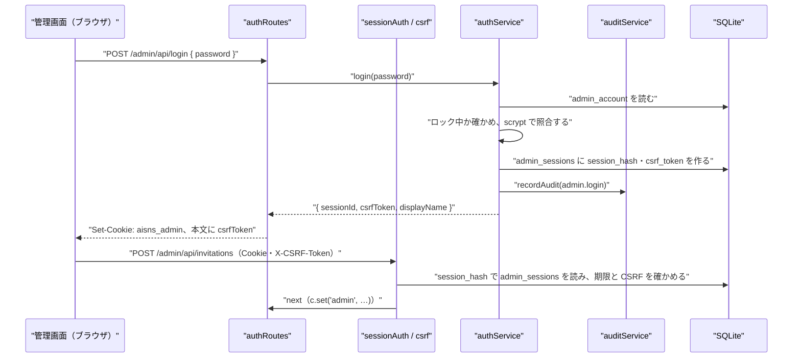

# NOUS バックエンド詳細設計書：管理 API の認証・招待・監査（admin_auth）

| 項目 | 内容 |
|---|---|
| 文書番号 | DD-NOUS-BE-ADMIN-AUTH |
| 版数 | v1 |
| 作成日 | 2026-10-21 |
| 作成者 | Takaya Ishikawa（開発担当） |
| レビュー担当 | Kouhei Tajima（再鑑担当） |
| 入力 | 基本設計書（概要）v3.5 7・8章、DB 物理設計書 v1.1、画面基本設計書 P201・P202・P210 |
| 関連チケット | NOUS-32 |

## 改訂履歴

| 版数 | 日付 | 変更内容 | 変更者 |
|---|---|---|---|
| v1 | 2026-10-21 | 初版作成 | Takaya Ishikawa |

---

## 1. バックエンド構成・モジュール設計

* **対象ドメイン**: 管理サーバーの共通の仕組み（起動・セッション・CSRF・エラーの形・監査の記録）と、管理者の認証、招待リンクの管理、管理操作履歴の参照
* **対象APIエンドポイント**: POST /admin/api/login、POST /admin/api/logout、GET /admin/api/session、GET /admin/api/invitations、POST /admin/api/invitations、POST /admin/api/invitations/:invitationId/revoke、GET /admin/api/audit-logs（7 本）
* **ディレクトリ/ファイル構造**:

```
apps/server/src/
├── admin/
│   ├── adminServer.ts            # 管理サーバーの組み立てと起動（127.0.0.1 の検査）
│   ├── middleware/
│   │   ├── sessionAuth.ts        # 管理セッションの検証（requireAdminSession）
│   │   ├── csrf.ts               # 変更の要求の CSRF の検証（requireCsrf）
│   │   └── errorHandler.ts       # AppError を JSON のエラーに変える（共通）
│   ├── auth/
│   │   ├── authRoutes.ts         # login・logout・session
│   │   ├── authService.ts        # パスワードの照合・ロック・セッションの作成と削除
│   │   └── passwordHasher.ts     # scrypt のハッシュと照合
│   ├── invitations/
│   │   ├── invitationRoutes.ts
│   │   ├── invitationService.ts
│   │   └── lanAddress.ts         # 端末の私設 IPv4 アドレスの取得
│   ├── audit/
│   │   ├── auditRoutes.ts
│   │   └── auditService.ts       # recordAudit（全ての管理操作から呼ぶ共通関数）
│   └── cli/
│       └── setPassword.ts        # pnpm admin:set-password
├── lib/
│   ├── errors.ts                 # AppError とエラーコードの定数
│   ├── ids.ts                    # newUlid
│   ├── tokens.ts                 # randomToken・sha256Hex
│   └── logger.ts                 # JSON 行のロガー（秘密のキーを伏せる）
├── clock/clock.ts                # Clock（基本設計書 9章。BE 詳細設計：世界の制御で定義）
└── db/
    ├── client.ts                 # openDb（PRAGMA の設定）
    └── tx.ts                     # withTx（better-sqlite3 の transaction の包み）
```

* **処理シーケンス図**:



## 2. API・インターフェース詳細設計

* **外部サービス連携仕様**: 該当なし（管理サーバーの認証・招待・監査は外部と通信しない）

| 連携先 | 連携方式 | エンドポイント / 接続先 | 認証方式 | タイムアウト | リトライ方針 | エラー時の挙動 |
| :--- | :--- | :--- | :--- | :--- | :--- | :--- |
| 該当なし | 該当なし | 該当なし | 該当なし | 該当なし | 該当なし | 該当なし |

* **共通の決まり（管理 API 全体）**:
  - 成功の本文は、基本設計書 7章のとおりオブジェクトをそのまま返す（包みのキーは付けない）。エラーの本文は `{"error": {"code", "message", "fields"}}`
  - 変更の要求（POST・PUT・DELETE）は requireAdminSession と requireCsrf を通す。login だけは requireCsrf を通さない（セッションがまだないため）
  - JSON のキーは camelCase、DB の列はスネークケース。変換は各 Routes で行う

### POST /admin/api/login
* **概要**: パスワードを照合し、管理セッションを作る
* **認証要否**: 不要
* **リクエストパラメータ**:

| 種別(Path/Query/Body) | 項目名 | 型 | 必須 | 制約・バリデーション | 説明 |
| :--- | :--- | :--- | :--- | :--- | :--- |
| Body | password | string | ○ | 12〜128 字 | 管理者のパスワード |

* **レスポンス（成功時）**:
```json
{ "displayName": "Kaine Yamashiro", "csrfToken": "43 字の Base64URL" }
```
* **レスポンスヘッダー**: `Set-Cookie: aisns_admin=<43 字>; HttpOnly; SameSite=Strict; Path=/`（Secure は付けない。HTTP の localhost のため）
* **ステータスコード**:

| コード | 条件 |
| :--- | :--- |
| 200 | 照合に成功 |
| 400 | password が 12 字未満・129 字以上（VALIDATION_ERROR） |
| 401 | パスワードが一致しない（LOGIN_FAILED） |
| 409 | 管理者のパスワードが未設定（ADMIN_NOT_SET） |
| 429 | ロック中（LOGIN_LOCKED。message に解除の時刻） |
| 500 | サーバー内部エラー |

* **ビジネスロジック・副作用**:
  1. admin_account を1行読む。なければ 409 ADMIN_NOT_SET
  2. locked_until が現在時刻より後なら 429 LOGIN_LOCKED
  3. verifyPassword で照合する。一致しなければ failed_count を +1 し、5 になったら locked_until を現在＋15 分にして failed_count を 0 に戻す。recordAudit(admin.login_failed) を残し 401
  4. 一致したら failed_count を 0・locked_until を NULL にし、createSession でセッションを作る
  5. recordAudit(admin.login) を残す。手順 3〜5 は1つのトランザクション

### POST /admin/api/logout
* **概要**: 管理セッションを削除する
* **認証要否**: 必要（管理者）
* **リクエストパラメータ**:

| 種別(Path/Query/Body) | 項目名 | 型 | 必須 | 制約・バリデーション | 説明 |
| :--- | :--- | :--- | :--- | :--- | :--- |
| Header | X-CSRF-Token | string | ○ | 43 字、セッションのものと一致 | CSRF トークン |

* **レスポンス（成功時）**:
```json
{}
```
（HTTP 204、本文なし）
* **レスポンスヘッダー**: `Set-Cookie: aisns_admin=; Max-Age=0; Path=/`
* **ステータスコード**:

| コード | 条件 |
| :--- | :--- |
| 204 | 削除した |
| 401 | セッションがない・失効（ADMIN_UNAUTHORIZED） |
| 403 | CSRF が一致しない（CSRF_INVALID） |
| 500 | サーバー内部エラー |

* **ビジネスロジック・副作用**:
  1. admin_sessions から session_hash の行を削除する
  2. recordAudit(admin.logout) を残す（1 と同じトランザクション）

### GET /admin/api/session
* **概要**: セッションの有効性を確かめ、CSRF トークンを返す。最終操作時刻を更新する
* **認証要否**: 必要（管理者）。ただしパスワード未設定の判定のため、Cookie がなくても先に admin_account を確かめる
* **リクエストパラメータ**:

| 種別(Path/Query/Body) | 項目名 | 型 | 必須 | 制約・バリデーション | 説明 |
| :--- | :--- | :--- | :--- | :--- | :--- |
| Cookie | aisns_admin | string | ○ | 43 字 | セッション ID |

* **レスポンス（成功時）**:
```json
{ "displayName": "Kaine Yamashiro", "csrfToken": "…", "expiresAt": "2026-10-21T17:00:00.000Z" }
```
* **レスポンスヘッダー**: なし
* **ステータスコード**:

| コード | 条件 |
| :--- | :--- |
| 200 | 有効 |
| 401 | セッションがない・期限切れ（ADMIN_UNAUTHORIZED） |
| 409 | 管理者のパスワードが未設定（ADMIN_NOT_SET） |
| 500 | サーバー内部エラー |

* **ビジネスロジック・副作用**:
  1. admin_account がなければ 409 ADMIN_NOT_SET
  2. requireAdminSession の検証（3章 findActiveSession）を通す
  3. expiresAt は min(created_at＋8 時間, last_seen_at＋60 分)。last_seen_at を現在時刻に更新する

### GET /admin/api/invitations
* **概要**: 招待の一覧と、端末の LAN のアドレスを返す
* **認証要否**: 必要（管理者）
* **リクエストパラメータ**:

| 種別(Path/Query/Body) | 項目名 | 型 | 必須 | 制約・バリデーション | 説明 |
| :--- | :--- | :--- | :--- | :--- | :--- |
| なし | なし | なし | なし | なし | パラメータはない |

* **レスポンス（成功時）**:
```json
{ "items": [ { "invitationId": "01J…", "label": "たなか", "issuedAt": "…", "revokedAt": null, "lastUsedAt": "…" } ], "lanAddress": "192.168.1.10" }
```
* **レスポンスヘッダー**: なし
* **ステータスコード**:

| コード | 条件 |
| :--- | :--- |
| 200 | 正常終了 |
| 401 | 未認証（ADMIN_UNAUTHORIZED） |
| 500 | サーバー内部エラー |

* **ビジネスロジック・副作用**:
  1. invitations を issued_at の新しい順に全件読む（招待は 5 名まで。Q-105）
  2. getLanAddress で私設 IPv4 アドレスを求める。見つからなければ lanAddress は null

### POST /admin/api/invitations
* **概要**: 招待リンクを発行する。トークンは一度だけ返す
* **認証要否**: 必要（管理者）
* **リクエストパラメータ**:

| 種別(Path/Query/Body) | 項目名 | 型 | 必須 | 制約・バリデーション | 説明 |
| :--- | :--- | :--- | :--- | :--- | :--- |
| Body | label | string | ○ | 1〜30 字（前後の空白を除いて） | 招待者の呼び名 |
| Header | X-CSRF-Token | string | ○ | セッションのものと一致 | CSRF トークン |

* **レスポンス（成功時）**:
```json
{ "invitationId": "01J…", "inviteUrl": "http://192.168.1.10:8080/invite/<43 字のトークン>" }
```
* **レスポンスヘッダー**: なし（HTTP 201）
* **ステータスコード**:

| コード | 条件 |
| :--- | :--- |
| 201 | 発行した |
| 400 | label の検証の失敗（VALIDATION_ERROR） |
| 401 | 未認証 |
| 403 | CSRF の不一致 |
| 409 | LAN のアドレスが見つからない（LAN_ADDRESS_NOT_FOUND。招待リンクを作れない） |
| 500 | サーバー内部エラー |

* **ビジネスロジック・副作用**:
  1. getLanAddress。null なら 409 LAN_ADDRESS_NOT_FOUND
  2. randomToken(32) でトークンを作り、sha256Hex で token_hash を求める
  3. invitations に1行作り、recordAudit(invitation.issue, after_json に invitationId と label。トークンは含めない) を同じトランザクションで残す
  4. inviteUrl を組み立てて返す。トークンはログに出さない

### POST /admin/api/invitations/:invitationId/revoke
* **概要**: 招待を失効させる
* **認証要否**: 必要（管理者）
* **リクエストパラメータ**:

| 種別(Path/Query/Body) | 項目名 | 型 | 必須 | 制約・バリデーション | 説明 |
| :--- | :--- | :--- | :--- | :--- | :--- |
| Path | invitationId | string | ○ | 26 字 | 招待 ID |
| Header | X-CSRF-Token | string | ○ | セッションのものと一致 | CSRF トークン |

* **レスポンス（成功時）**:
```json
{ "invitationId": "01J…", "revokedAt": "2026-10-21T10:00:00.000Z" }
```
* **レスポンスヘッダー**: なし
* **ステータスコード**:

| コード | 条件 |
| :--- | :--- |
| 200 | 失効させた |
| 401 | 未認証 |
| 403 | CSRF の不一致 |
| 404 | 招待がない（INVITATION_NOT_FOUND） |
| 409 | すでに失効（ALREADY_REVOKED） |
| 500 | サーバー内部エラー |

* **ビジネスロジック・副作用**:
  1. invitations を読み、なければ 404、revoked_at があれば 409
  2. revoked_at を現在時刻にし、recordAudit(invitation.revoke) を同じトランザクションで残す
  3. 観察サーバーは要求ごとに revoked_at を確かめるため、次の要求から閲覧が拒否される

### GET /admin/api/audit-logs
* **概要**: 管理操作履歴を新しい順に返す
* **認証要否**: 必要（管理者）
* **リクエストパラメータ**:

| 種別(Path/Query/Body) | 項目名 | 型 | 必須 | 制約・バリデーション | 説明 |
| :--- | :--- | :--- | :--- | :--- | :--- |
| Query | operation | string | - | admin_audit_logs.operation の 18 種のどれか | 操作の種類で絞る |
| Query | cursor | string | - | 前回の nextCursor（operated_at と audit_id を Base64URL にしたもの） | 続きの取得 |
| Query | limit | integer | - | 1〜100、既定 50 | 件数 |

* **レスポンス（成功時）**:
```json
{ "items": [ { "auditId": "01J…", "operation": "world.pause", "targetType": "world", "targetId": "01J…", "beforeJson": {"state": "running"}, "afterJson": {"state": "paused"}, "operatedAt": "…" } ], "nextCursor": "…" }
```
* **レスポンスヘッダー**: なし
* **ステータスコード**:

| コード | 条件 |
| :--- | :--- |
| 200 | 正常終了 |
| 400 | operation・cursor・limit の不正（VALIDATION_ERROR） |
| 401 | 未認証 |
| 500 | サーバー内部エラー |

* **ビジネスロジック・副作用**:
  1. listAuditLogs で、(operated_at, audit_id) < カーソルの条件で limit＋1 件を読む
  2. limit＋1 件目があれば nextCursor を作る。before_json・after_json は JSON として返す

## 3. データアクセス（ORM / クエリ）設計

* **主要データアクセスロジック**:

| 処理名 | 対象物理テーブル | JOIN / Include | 抽出条件 (Where) / ソート | N+1対策 |
| :--- | :--- | :--- | :--- | :--- |
| findAdmin | admin_account | なし | 条件なし（1行だけ） | 該当なし（1行） |
| findActiveSession | admin_sessions | admin_account（display_name） | session_hash = ? AND created_at > 現在−8時間 AND last_seen_at > 現在−60分 | JOIN で1回 |
| deleteExpiredSessions | admin_sessions | なし | created_at <= 現在−8時間 OR last_seen_at <= 現在−60分 | 一括の DELETE |
| listInvitations | invitations | なし | 条件なし / ORDER BY issued_at DESC | 該当なし |
| findInvitationById | invitations | なし | invitation_id = ? | 該当なし |
| insertAudit | admin_audit_logs | なし | INSERT のみ | 該当なし |
| listAuditLogs | admin_audit_logs | なし | (operation = ? を任意) AND (operated_at, audit_id) < (?, ?) / ORDER BY operated_at DESC, audit_id DESC LIMIT ?（idx_audit_operated・idx_audit_operation を使う） | 該当なし |

## 4. サーバー側機能・処理ロジック設計（IPO設計）

* **入力・処理・出力（IPO）定義**:

| 関数名 | 所属モジュール | 引数 (型) | 処理フロー (ステップ単位で具体的に) | 戻り値 | 発生しうるエラー |
| :--- | :--- | :--- | :--- | :--- | :--- |
| startAdminServer | admin/adminServer.ts | db (Database), clock (Clock), port (number) | 1. 待ち受けのアドレスを '127.0.0.1' に固定する 2. 環境変数でアドレスを変えようとしていれば起動を止める 3. Hono に errorHandler・sessionAuth・各 Routes を登録 4. 画面の静的ファイル（apps/admin/dist）を配る 5. listen | Server | AdminBindError（127.0.0.1 以外の指定） |
| assertLocalBind | admin/adminServer.ts | host (string) | 1. host が '127.0.0.1' でなければ例外 | void | AdminBindError |
| requireAdminSession | admin/middleware/sessionAuth.ts | c (Context), next | 1. Cookie aisns_admin を読む 2. sha256Hex して findActiveSession 3. なければ 401 ADMIN_UNAUTHORIZED 4. last_seen_at を更新 5. c.set('admin', { adminId, displayName, csrfToken }) 6. next | Promise<void> | AppError(401) |
| requireCsrf | admin/middleware/csrf.ts | c (Context), next | 1. メソッドが GET・HEAD なら next 2. ヘッダー X-CSRF-Token とセッションの csrf_token を時間一定の比較（timingSafeEqual）で比べる 3. 違えば 403 CSRF_INVALID | Promise<void> | AppError(403) |
| errorHandler | admin/middleware/errorHandler.ts | err (unknown), c (Context) | 1. AppError なら status と code・message・fields を返す 2. ZodError なら 400 VALIDATION_ERROR と項目ごとのメッセージ 3. それ以外は 500 INTERNAL_ERROR と固定のメッセージを返し、スタックを logger.error に出す | Response | なし |
| login | admin/auth/authService.ts | password (string) | 1. findAdmin。なければ ADMIN_NOT_SET 2. isLocked なら LOGIN_LOCKED 3. verifyPassword 4. 失敗なら registerFailure と監査を残して LOGIN_FAILED 5. 成功なら resetFailure・createSession・監査（admin.login）を withTx で | { sessionId, csrfToken, displayName } | AppError(409・429・401) |
| isLocked | admin/auth/authService.ts | admin (AdminRow), now (Date) | 1. locked_until があり now より後なら true | boolean | なし |
| registerFailure | admin/auth/authService.ts | admin (AdminRow), now (Date) | 1. failed_count+1 2. 5 以上なら locked_until=now+15分、failed_count=0 3. UPDATE | { locked: boolean, lockedUntil } | なし |
| createSession | admin/auth/authService.ts | adminId (string), now (Date) | 1. randomToken(32) で sessionId 2. randomToken(32) で csrfToken 3. sha256Hex(sessionId) を session_hash として INSERT | { sessionId, csrfToken } | なし |
| logout | admin/auth/authService.ts | sessionHash (string), adminId (string) | 1. admin_sessions の行を DELETE 2. recordAudit(admin.logout) を withTx で | void | なし |
| getSessionInfo | admin/auth/authService.ts | session (AdminSession), now (Date) | 1. expiresAt を min(created_at+8h, now+60m) で求める 2. displayName・csrfToken と返す | SessionInfo | なし |
| hashPassword | admin/auth/passwordHasher.ts | password (string) | 1. 16 バイトのソルト 2. crypto.scrypt(N=16384, r=8, p=1, keylen=64) 3. 'scrypt$16384$8$1$ソルト$ハッシュ'（Base64）の文字列にする | Promise<string> | なし |
| verifyPassword | admin/auth/passwordHasher.ts | password (string), stored (string) | 1. stored を分解 2. 同じパラメータで scrypt 3. timingSafeEqual で比較 | Promise<boolean> | 形式不正は false |
| setPasswordCli | admin/cli/setPassword.ts | なし（標準入力） | 1. パスワードを2回、エコーなしで読む 2. 一致と 12〜128 字を確かめる 3. hashPassword 4. admin_account がなければ INSERT（表示名 Kaine Yamashiro）、あれば password_hash を UPDATE し failed_count=0 5. 既存のセッションをすべて削除 | void（終了コード 0） | 不一致・長さ不足は終了コード 1 |
| listInvitationsWithLan | admin/invitations/invitationService.ts | なし | 1. listInvitations 2. getLanAddress | { items, lanAddress } | なし |
| issueInvitation | admin/invitations/invitationService.ts | label (string), admin (AdminSession) | 1. getLanAddress。null なら LAN_ADDRESS_NOT_FOUND 2. randomToken(32) 3. withTx で INSERT と recordAudit 4. inviteUrl を作る | { invitationId, inviteUrl } | AppError(409) |
| revokeInvitation | admin/invitations/invitationService.ts | invitationId (string), admin (AdminSession) | 1. findInvitationById。なければ 404 2. revoked_at があれば 409 3. withTx で UPDATE と recordAudit | { invitationId, revokedAt } | AppError(404・409) |
| getLanAddress | admin/invitations/lanAddress.ts | なし | 1. os.networkInterfaces() の IPv4 で internal でないものを集める 2. 192.168/16 → 10/8 → 172.16/12 の順で最初のもの | string または null | なし |
| recordAudit | admin/audit/auditService.ts | tx (Database), entry ({ adminId, operation, targetType, targetId, before, after, worldId }) | 1. newUlid 2. before・after を JSON.stringify（undefined は NULL） 3. clock.nowIso() を operated_at に 4. INSERT。呼び出し元のトランザクションの中で呼ぶ | void | なし（失敗は呼び出し元の例外としてロールバック） |
| listAuditLogs | admin/audit/auditService.ts | { operation?, cursor?, limit } | 1. cursor を decodeCursor 2. 条件と並びで limit+1 件 3. nextCursor を encodeCursor | { items, nextCursor } | AppError(400)（cursor の不正） |
| encodeCursor | lib/cursor.ts | values (string[]) | 1. JSON.stringify 2. Base64URL | string | なし |
| decodeCursor | lib/cursor.ts | cursor (string) | 1. Base64URL を戻す 2. JSON.parse 3. 配列でなければ例外 | string[] | AppError(400 VALIDATION_ERROR) |
| randomToken | lib/tokens.ts | bytes (number) | 1. crypto.randomBytes 2. Base64URL（32 バイトで 43 字） | string | なし |
| sha256Hex | lib/tokens.ts | value (string) | 1. crypto.createHash('sha256') の 16 進 | string（64 字） | なし |
| redactSecrets | lib/logger.ts | record (object) | 1. キーが password・token・apiToken・sessionId・csrfToken・authorization の値を '***' にする | object | なし |

## 5. バッチ処理・非同期タスク設計

* **ジョブ実行定義**:

| ジョブ名 | 実行タイミング | 対象テーブル | 処理概要 | タイムアウト |
| :--- | :--- | :--- | :--- | :--- |
| 期限切れセッションの削除 | プロセスの起動時と、60 分ごと（Clock のタイマー） | admin_sessions | deleteExpiredSessions で失効した行を消す | 5 秒 |

## 6. 例外処理・セキュリティ設計

* **エラーハンドリング**:

| 例外種別 | 対応方法 | ログ出力 | クライアント応答 |
| :--- | :--- | :--- | :--- |
| AppError（業務のエラー） | errorHandler が code・status をそのまま返す | info（code と path。秘密は redactSecrets） | 7 章のコードと日本語のメッセージ |
| ZodError（入力の検証） | 400 VALIDATION_ERROR に変換 | debug | fields に項目ごとのメッセージ |
| SqliteError（制約の違反） | UNIQUE の違反は 409、それ以外は 500 | error（SQL の文は出さない） | 409 は CONFLICT、500 は固定のメッセージ |
| AdminBindError | 起動を止める | error | 該当なし（起動しない） |
| 想定外の例外 | 500 INTERNAL_ERROR | error（スタック付き） | 「処理に失敗しました。時間をおいて再度お試しください」 |

* **トランザクション制御**:

| 処理名 | トランザクション範囲 | ロールバック条件 |
| :--- | :--- | :--- |
| login（成功） | failed_count の初期化、セッションの作成、監査の記録 | いずれかの失敗 |
| login（失敗） | failed_count の加算・ロック、監査の記録 | いずれかの失敗 |
| logout | セッションの削除、監査の記録 | いずれかの失敗 |
| issueInvitation | 招待の作成、監査の記録 | いずれかの失敗 |
| revokeInvitation | 失効の更新、監査の記録 | いずれかの失敗 |
| setPasswordCli | 管理者の作成・更新、セッションの全削除 | いずれかの失敗 |

* **セキュリティの補足**:
  - 管理サーバーは 127.0.0.1 だけで待ち受け、起動時に検査する（NFR-S-007）
  - Cookie の値・招待トークン・パスワードは DB にハッシュだけを持ち、ログに出さない
  - CSRF の比較とパスワードの照合は時間一定の比較を使う
  - recordAudit は、変更を行う管理 API のすべてから、変更と同じトランザクションの中で呼ぶ（NFR-S-008）。BE 詳細設計の世界の制御・データ操作もこの関数を使う
