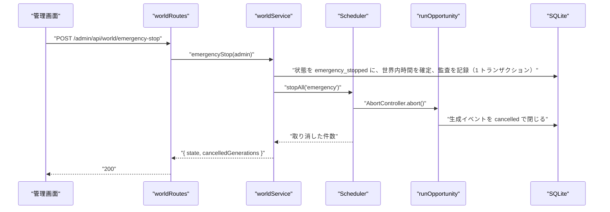

# NOUS バックエンド詳細設計書：世界の制御とスケジューラー（world）

| 項目 | 内容 |
|---|---|
| 文書番号 | DD-NOUS-BE-WORLD |
| 版数 | v1.2 |
| 作成日 | 2026-10-21 |
| 作成者 | Takaya Ishikawa（開発担当） |
| レビュー担当 | Kouhei Tajima（再鑑担当） |
| 入力 | 基本設計書（概要）v3.6 4・6・7・9章、DB 物理設計書 v1.1、BE 詳細設計 admin_auth v1・generation v1.1、画面基本設計書 P202・P205 |
| 関連チケット | NOUS-30 |

## 改訂履歴

| 版数 | 日付 | 変更内容 | 変更者 |
|---|---|---|---|
| v1 | 2026-10-21 | 初版作成 | Takaya Ishikawa |
| v1.1 | 2026-10-21 | 第1回レビューの指摘（M-01・m-01）の反映。準備中の世界はリセットできないことに統一 | Takaya Ishikawa |
| v1.2 | 2026-10-21 | FE admin_control のレビューの指摘（NOUS-35 m-01）の反映。GET /admin/api/settings の応答に activeAgents・avgParticipation を追加 | Takaya Ishikawa |

---

## 1. バックエンド構成・モジュール設計

* **対象ドメイン**: 世界の状態の遷移（開始・一時停止・再開・緊急停止・リセット）、世界内時間、上限の判定、実行設定、スケジューラー（B01 1巡・B02 日の区切り・B06 バックアップ・B07 起動時の後始末・B08 生存時刻）、時計（Clock）
* **対象APIエンドポイント**: GET /admin/api/world、POST /admin/api/world/start、POST /admin/api/world/pause、POST /admin/api/world/resume、POST /admin/api/world/emergency-stop、POST /admin/api/world/reset、GET /admin/api/settings、PUT /admin/api/settings（8 本）
* **ディレクトリ/ファイル構造**:

```
apps/server/src/
├── clock/
│   ├── clock.ts            # Clock のインタフェース、SystemClock
│   └── fakeClock.ts        # FakeClock（AISNS_CLOCK=fake、test だけ）
├── world/
│   ├── worldRoutes.ts      # /admin/api/world*
│   ├── worldService.ts     # 状態の遷移の操作（start・pause・resume・emergencyStop・reset）
│   ├── stateMachine.ts     # 遷移の表と判定（canTransition）
│   ├── worldTime.ts        # 世界内時間の計算と確定
│   ├── limits.ts           # 上限の判定（isWithinLimits・limitReason）
│   ├── settingsRoutes.ts   # /admin/api/settings
│   └── settingsService.ts  # 設定の取得・検証・保存・見込みの計算
├── scheduler/
│   ├── scheduler.ts        # Scheduler（B01 の巡の実行と停止の指示）
│   ├── dayRollover.ts      # B02
│   ├── backup.ts           # B06
│   ├── startupRecovery.ts  # B07
│   └── heartbeat.ts        # B08
└── main.ts                 # 起動の順（B07 → B06 → 両サーバー → Scheduler）
```

* **処理シーケンス図**:



## 2. API・インターフェース詳細設計

* **外部サービス連携仕様**: 該当なし（この領域は外部と通信しない。LLM の呼び出しは BE 詳細設計 generation）

| 連携先 | 連携方式 | エンドポイント / 接続先 | 認証方式 | タイムアウト | リトライ方針 | エラー時の挙動 |
| :--- | :--- | :--- | :--- | :--- | :--- | :--- |
| 該当なし | 該当なし | 該当なし | 該当なし | 該当なし | 該当なし | 該当なし |

* **API詳細仕様**: 全 API で requireAdminSession を、変更の API で requireCsrf を通す（admin_auth）。

### GET /admin/api/world
* **概要**: 現在の世界の状態・停止理由・世界内時間・巡・次の巡・利用日の利用量と上限・実行中の生成の数を返す（P202、管理画面のヘッダー）
* **認証要否**: 必要（管理者）
* **リクエストパラメータ**:

| 種別(Path/Query/Body) | 項目名 | 型 | 必須 | 制約・バリデーション | 説明 |
| :--- | :--- | :--- | :--- | :--- | :--- |
| なし | なし | なし | なし | なし | パラメータはない |

* **レスポンス（成功時）**:
```json
{ "worldId": "01J…", "name": "世界 2026-10-22", "state": "running", "stopReason": null, "worldTimeSec": 7260, "cycleNo": 22, "nextCycleAt": "2026-10-22T05:40:00.000Z", "usage": { "usageDate": "2026-10-22", "neurons": 2104.5, "neuronsLimit": 9500, "runs": 132, "runsLimit": 480, "freeTierNeurons": 10000 }, "runningGenerations": 1, "agentCounts": { "active": 9, "stopped": 1 } }
```
* **レスポンスヘッダー**: なし
* **ステータスコード**:

| コード | 条件 |
| :--- | :--- |
| 200 | 正常終了 |
| 401 | 未認証（ADMIN_UNAUTHORIZED） |
| 500 | サーバー内部エラー |

* **ビジネスロジック・副作用**:
  1. findCurrentWorld（archived 以外の1行）。なければ createInitialWorld で準備中の世界を作る（初回の起動）
  2. getWorldTimeSec で世界内時間を求める
  3. getUsage（今日の利用日の daily_usage）と world_settings の上限を並べる
  4. Scheduler.runningCount と、agents の state ごとの数を返す

### POST /admin/api/world/start
* **概要**: 準備中の世界を開始する
* **認証要否**: 必要（管理者）
* **リクエストパラメータ**:

| 種別(Path/Query/Body) | 項目名 | 型 | 必須 | 制約・バリデーション | 説明 |
| :--- | :--- | :--- | :--- | :--- | :--- |
| Header | X-CSRF-Token | string | ○ | セッションと一致 | CSRF トークン |

* **レスポンス（成功時）**:
```json
{ "state": "running", "startedAt": "2026-10-22T00:00:00.000Z" }
```
* **レスポンスヘッダー**: なし
* **ステータスコード**:

| コード | 条件 |
| :--- | :--- |
| 200 | 開始した（上限に達していれば state は limit_stopped） |
| 401 | 未認証 |
| 403 | CSRF の不一致 |
| 409 | 準備中以外（STATE_CONFLICT）、エージェントが0体（NO_AGENTS） |
| 500 | サーバー内部エラー |

* **ビジネスロジック・副作用**:
  1. withTx：世界を読み、preparing でなければ STATE_CONFLICT。active のエージェントが0体なら NO_AGENTS
  2. isWithinLimits なら running（running_since・heartbeat_at を現在、started_at を現在、next_cycle_at を現在）、そうでなければ limit_stopped（stop_reason は limitReason）
  3. recordAudit(world.start, before・after の state)
  4. トランザクションの後、Scheduler.wake() で最初の巡を直ちに始める

### POST /admin/api/world/pause
* **概要**: 稼働・上限停止の世界を一時停止する
* **認証要否**: 必要（管理者）
* **リクエストパラメータ**:

| 種別(Path/Query/Body) | 項目名 | 型 | 必須 | 制約・バリデーション | 説明 |
| :--- | :--- | :--- | :--- | :--- | :--- |
| Header | X-CSRF-Token | string | ○ | セッションと一致 | CSRF トークン |

* **レスポンス（成功時）**:
```json
{ "state": "paused", "worldTimeSec": 7260, "runningGenerations": 1 }
```
* **レスポンスヘッダー**: なし
* **ステータスコード**:

| コード | 条件 |
| :--- | :--- |
| 200 | 一時停止した |
| 401 | 未認証 |
| 403 | CSRF の不一致 |
| 409 | running・limit_stopped 以外（STATE_CONFLICT） |
| 500 | サーバー内部エラー |

* **ビジネスロジック・副作用**:
  1. withTx：canTransition(state, 'paused') でなければ STATE_CONFLICT
  2. running からなら settleWorldTime で world_elapsed_sec を確定し running_since を NULL
  3. state=paused、stop_reason=manual_pause、recordAudit(world.pause)
  4. トランザクションの後、Scheduler.stopAll('pause')：新規の割り当てを止め、再試行の待ちを打ち切る（実行中の LLM の呼び出しは完了を待つ。最大 60 秒）

### POST /admin/api/world/resume
* **概要**: 一時停止・緊急停止の世界を再開する
* **認証要否**: 必要（管理者）
* **リクエストパラメータ**:

| 種別(Path/Query/Body) | 項目名 | 型 | 必須 | 制約・バリデーション | 説明 |
| :--- | :--- | :--- | :--- | :--- | :--- |
| Header | X-CSRF-Token | string | ○ | セッションと一致 | CSRF トークン |

* **レスポンス（成功時）**:
```json
{ "state": "running", "stopReason": null }
```
* **レスポンスヘッダー**: なし
* **ステータスコード**:

| コード | 条件 |
| :--- | :--- |
| 200 | 再開した（上限に達していれば limit_stopped と理由） |
| 401 | 未認証 |
| 403 | CSRF の不一致 |
| 409 | paused・emergency_stopped 以外（STATE_CONFLICT） |
| 500 | サーバー内部エラー |

* **ビジネスロジック・副作用**:
  1. withTx：canTransition を確かめる
  2. isWithinLimits なら running（running_since・heartbeat_at を現在、stop_reason を NULL、next_cycle_at は max(現在, 既存の予定)）。そうでなければ limit_stopped と limitReason
  3. recordAudit(world.resume)
  4. running なら Scheduler.wake()

### POST /admin/api/world/emergency-stop
* **概要**: 実行中の生成を取り消して即時に止める
* **認証要否**: 必要（管理者）
* **リクエストパラメータ**:

| 種別(Path/Query/Body) | 項目名 | 型 | 必須 | 制約・バリデーション | 説明 |
| :--- | :--- | :--- | :--- | :--- | :--- |
| Header | X-CSRF-Token | string | ○ | セッションと一致 | CSRF トークン |

* **レスポンス（成功時）**:
```json
{ "state": "emergency_stopped", "cancelledGenerations": 1 }
```
* **レスポンスヘッダー**: なし
* **ステータスコード**:

| コード | 条件 |
| :--- | :--- |
| 200 | 緊急停止した |
| 401 | 未認証 |
| 403 | CSRF の不一致 |
| 409 | running・paused・limit_stopped 以外（STATE_CONFLICT） |
| 500 | サーバー内部エラー |

* **ビジネスロジック・副作用**:
  1. withTx：canTransition。running からなら settleWorldTime。state=emergency_stopped、stop_reason=emergency、recordAudit(world.emergency_stop)
  2. トランザクションの後、Scheduler.stopAll('emergency')：全ての実行中の AbortController を abort し、最大 5 秒、生成イベントが閉じるのを待つ
  3. 5 秒を過ぎても閉じない生成イベントは、その場で cancelled（cancelled）に更新する
  4. 取り消した件数を返す

### POST /admin/api/world/reset
* **概要**: 現在の世界をアーカイブにし、同じエージェントと設定を写した新しい世界を準備中で作る
* **認証要否**: 必要（管理者）
* **リクエストパラメータ**:

| 種別(Path/Query/Body) | 項目名 | 型 | 必須 | 制約・バリデーション | 説明 |
| :--- | :--- | :--- | :--- | :--- | :--- |
| Body | confirmName | string | ○ | 現在の世界の name と完全一致 | 確認の入力 |
| Header | X-CSRF-Token | string | ○ | セッションと一致 | CSRF トークン |

* **レスポンス（成功時）**:
```json
{ "archivedWorldId": "01J…", "newWorldId": "01J…", "state": "preparing" }
```
* **レスポンスヘッダー**: なし
* **ステータスコード**:

| コード | 条件 |
| :--- | :--- |
| 200 | リセットした |
| 400 | confirmName の不一致（CONFIRM_MISMATCH） |
| 401 | 未認証 |
| 403 | CSRF の不一致 |
| 409 | running・preparing（STATE_CONFLICT。running は先に一時停止か緊急停止が要る。preparing には消す活動がない）、または実行中の生成が残っている（GENERATION_RUNNING） |
| 500 | サーバー内部エラー |

* **ビジネスロジック・副作用**:
  1. withTx：世界を読み、running か preparing なら STATE_CONFLICT（canTransition(state, 'archived')）。confirmName が name と違えば CONFIRM_MISMATCH。status=running の生成イベントがあれば GENERATION_RUNNING
  2. 現在の世界を archived（archived_at を現在）にする。running_since は NULL のまま
  3. 新しい世界（name は「世界 YYYY-MM-DD」、同名があれば末尾に「-2」から番号）と world_settings（現在の値を写す）を作る
  4. 現在の世界の agents を、新しい agent_id で写す（人格・属性は同じ、state は active）。各エージェントの interest_profile の記憶を作る
  5. recordAudit(world.reset, before に旧の world_id、after に新の world_id)
  6. daily_usage は利用日の単位のため、何もしない（同じ日の利用量を引き継ぐ）

### GET /admin/api/settings
* **概要**: 実行設定と、直近の実測からの見込みを返す（P205）
* **認証要否**: 必要（管理者）
* **リクエストパラメータ**:

| 種別(Path/Query/Body) | 項目名 | 型 | 必須 | 制約・バリデーション | 説明 |
| :--- | :--- | :--- | :--- | :--- | :--- |
| なし | なし | なし | なし | なし | パラメータはない |

* **レスポンス（成功時）**:
```json
{ "settings": { "cycleMinutes": 20, "activityPercent": 100, "maxRefPosts": 12, "maxMemoryChars": 1200, "maxInputTokens": 1500, "maxOutputTokens": 300, "dailyNeuronsLimit": 9500, "dailyRunsLimit": 480, "maxConcurrency": 1, "modelId": "@cf/google/gemma-4-26b-a4b-it", "promptVersion": "v1" }, "avgNeuronsPerRun": 15.8, "activeAgents": 10, "avgParticipation": 0.6, "estimatedCycleMinutes": 15, "estimatedDailyRuns": 432, "estimatedDailyNeurons": 6826, "modelOptions": ["@cf/google/gemma-4-26b-a4b-it", "@cf/qwen/qwen3-30b-a3b-fp8"], "promptVersions": ["v1"] }
```
* **レスポンスヘッダー**: なし
* **ステータスコード**:

| コード | 条件 |
| :--- | :--- |
| 200 | 正常終了 |
| 401 | 未認証 |
| 500 | サーバー内部エラー |

* **ビジネスロジック・副作用**:
  1. world_settings を読む
  2. averageNeuronsPerRun（直近 50 件の成功した LLM の生成の平均。20 件未満なら見積もり 16.4）
  3. estimateDaily で見込みを計算する（4章）。計算に使った稼働中の体数（activeAgents）と参加の確率の平均（avgParticipation）も返し、画面が入力に合わせて同じ式で計算し直せるようにする
  4. prompts/ のフォルダ名を版の一覧として返す

### PUT /admin/api/settings
* **概要**: 実行設定を変更する
* **認証要否**: 必要（管理者）
* **リクエストパラメータ**:

| 種別(Path/Query/Body) | 項目名 | 型 | 必須 | 制約・バリデーション | 説明 |
| :--- | :--- | :--- | :--- | :--- | :--- |
| Body | cycleMinutes | integer | ○ | 15〜120 | 周期 |
| Body | activityPercent | integer | ○ | 10〜100 | 活動量 |
| Body | maxRefPosts | integer | ○ | 1〜30 | 参照する投稿の上限 |
| Body | maxMemoryChars | integer | ○ | 200〜3000 | 記憶の文字数の上限 |
| Body | maxInputTokens | integer | ○ | 500〜2000 | 最大入力トークン |
| Body | maxOutputTokens | integer | ○ | 100〜400 | 最大出力トークン |
| Body | dailyNeuronsLimit | integer | ○ | 1〜10000 | Neurons の日次上限 |
| Body | dailyRunsLimit | integer | ○ | 1〜2000 | 実行回数の日次上限 |
| Body | maxConcurrency | integer | ○ | 1〜3 | 並列数の上限 |
| Body | modelId | string | ○ | 2 値のどちらか | モデル |
| Body | promptVersion | string | ○ | prompts/ にある版 | プロンプトの版 |
| Header | X-CSRF-Token | string | ○ | セッションと一致 | CSRF トークン |

* **レスポンス（成功時）**:
```json
{ "settings": { "cycleMinutes": 20, "…": "…" }, "estimatedCycleMinutes": 15, "estimatedDailyRuns": 432, "stateChanged": "limit_stopped→running" }
```
* **レスポンスヘッダー**: なし
* **ステータスコード**:

| コード | 条件 |
| :--- | :--- |
| 200 | 保存した |
| 400 | 検証の失敗（VALIDATION_ERROR。fields に項目ごと） |
| 401 | 未認証 |
| 403 | CSRF の不一致 |
| 409 | 現在の世界が archived（起きない想定。STATE_CONFLICT） |
| 500 | サーバー内部エラー |

* **ビジネスロジック・副作用**:
  1. Zod の SettingsSchema で検証。promptVersion は listPromptVersions に含まれること
  2. withTx：world_settings を UPDATE、recordAudit(settings.update, before・after の全項目)
  3. 世界が limit_stopped で、新しい上限で isWithinLimits になれば running に戻し（running_since・heartbeat_at を現在）、stateChanged を返す
  4. 世界が running で、新しい上限を超えていれば limit_stopped にし、Scheduler.stopAll('limit')
  5. 周期と活動量は次の巡から反映（next_cycle_at は変えない）

## 3. データアクセス（ORM / クエリ）設計

* **主要データアクセスロジック**:

| 処理名 | 対象物理テーブル | JOIN / Include | 抽出条件 (Where) / ソート | N+1対策 |
| :--- | :--- | :--- | :--- | :--- |
| findCurrentWorld | worlds | world_settings | state <> 'archived'（ux_worlds_current により高々1行） | JOIN で1回 |
| countAgentsByState | agents | なし | world_id = ? / GROUP BY state | GROUP BY で1回 |
| listActiveAgents | agents | なし | world_id = ? AND state = 'active' / created_at（idx_agents_world_state） | 該当なし |
| getUsage | daily_usage | なし | usage_date = ? | 該当なし |
| countRunningEvents | generation_events | なし | world_id = ? AND status = 'running'（idx_gen_world_status） | 該当なし |
| closeOrphanEvents | generation_events | なし | status = 'running'（全世界） / UPDATE status='interrupted', failure_kind='interrupted', finished_at=? | 一括の UPDATE |
| averageNeuronsPerRun | generation_events | なし | decided_by = 'llm' AND status = 'succeeded' / started_at DESC LIMIT 50（idx_gen_llm_recent） | 該当なし |
| copyAgentsToWorld | agents、memories | なし | INSERT INTO agents SELECT …（新しい ID はアプリで採番するため、行ごとに INSERT。最大 30 体） | 1 トランザクションで最大 30 行 |
| updateWorldState | worlds | なし | world_id = ? AND state = ?（楽観の確認。0 行なら STATE_CONFLICT） | 該当なし |

## 4. サーバー側機能・処理ロジック設計（IPO設計）

* **入力・処理・出力（IPO）定義**:

| 関数名 | 所属モジュール | 引数 (型) | 処理フロー (ステップ単位で具体的に) | 戻り値 | 発生しうるエラー |
| :--- | :--- | :--- | :--- | :--- | :--- |
| now / nowIso / sleep / setTimer | clock/clock.ts（SystemClock） | ms (number), signal (AbortSignal) | 1. now は Date.now 2. sleep は setTimeout を Promise にし、signal の abort で拒否 3. setTimer は解除の関数を返す | Date・string・Promise<void>・() => void | CancelledError（sleep の abort） |
| advance | clock/fakeClock.ts（FakeClock） | ms (number) | 1. 内部の時刻を進める 2. 期限の来たタイマーと sleep を時刻の順に解決する | Promise<void> | なし |
| createClock | clock/clock.ts | env (string) | 1. AISNS_CLOCK=fake かつ NODE_ENV=test のときだけ FakeClock 2. それ以外は SystemClock | Clock | ConfigError（production で fake） |
| canTransition | world/stateMachine.ts | from (WorldState), to (WorldState) | 1. 基本設計書 6章の遷移の表（11 行）を定数で持ち、from→to があるか調べる | boolean | なし |
| getWorldTimeSec | world/worldTime.ts | world (WorldRow), now (Date) | 1. running なら world_elapsed_sec＋floor((now − running_since)/1000) 2. それ以外は world_elapsed_sec | number | なし |
| settleWorldTime | world/worldTime.ts | tx, world, now | 1. getWorldTimeSec 2. world_elapsed_sec に書き、running_since を NULL | number | なし |
| isWithinLimits | world/limits.ts | usage (DailyUsage), settings (WorldSettings) | 1. neurons < daily_neurons_limit かつ runs < daily_runs_limit | boolean | なし |
| limitReason | world/limits.ts | usage, settings | 1. neurons が上限以上なら neurons_limit 2. runs が上限以上なら runs_limit | 'neurons_limit' または 'runs_limit' | なし |
| startWorld | world/worldService.ts | admin (AdminSession) | 2章 start の手順 1〜4 | { state, startedAt } | AppError(409) |
| pauseWorld | world/worldService.ts | admin | 2章 pause の手順 1〜4 | { state, worldTimeSec, runningGenerations } | AppError(409) |
| resumeWorld | world/worldService.ts | admin | 2章 resume の手順 1〜4 | { state, stopReason } | AppError(409) |
| emergencyStopWorld | world/worldService.ts | admin | 2章 emergency-stop の手順 1〜4 | { state, cancelledGenerations } | AppError(409) |
| resetWorld | world/worldService.ts | admin, confirmName (string) | 2章 reset の手順 1〜6 | { archivedWorldId, newWorldId, state } | AppError(400・409) |
| nextWorldName | world/worldService.ts | tx, date (string) | 1. 「世界 YYYY-MM-DD」 2. 同名があれば「-2」「-3」と番号を足す | string | なし |
| createInitialWorld | world/worldService.ts | tx, now | 1. 準備中の世界と既定の world_settings を作る（初回の起動・世界がないとき） | WorldRow | なし |
| enterLimitStopped | world/worldService.ts | reason ('neurons_limit' または 'runs_limit' または 'free_tier_error') | 1. withTx：running なら settleWorldTime、state=limit_stopped、stop_reason 2. 監査は残さない（管理者の操作ではないため。理由は worlds.stop_reason に残る） 3. Scheduler.stopAll('limit') | void | なし（すでに limit_stopped なら何もしない） |
| getSettingsWithEstimate | world/settingsService.ts | なし | 2章 GET settings の手順 1〜4 | SettingsView | なし |
| updateSettings | world/settingsService.ts | input (SettingsInput), admin | 2章 PUT settings の手順 1〜5 | SettingsView と stateChanged | AppError(400) |
| estimateDaily | world/settingsService.ts | settings, avgNeurons, agents (AgentRow[]), config | 1. 参加の確率の平均 p̄ を、稼働中のエージェントの活動頻度から求める 2. 1巡の LLM の回数 = 体数×活動量×p̄ 3. 1日の巡 = 1440 ÷ 周期 4. 1日の回数と Neurons 5. 周期の下限 = 1440 ÷ (日次上限 ÷ 1巡の Neurons) を切り上げ | { cycleMinutesFloor, dailyRuns, dailyNeurons } | なし |
| listPromptVersions | world/settingsService.ts | なし | 1. prompts/ の直下のフォルダ名で、system.md と user.md がそろうもの | string[] | なし |
| Scheduler.start | scheduler/scheduler.ts | なし | 1. B08 のタイマー（60 秒）と、B02・B06 の 00:00 UTC のタイマーを Clock で張る 2. loop を始める | void | なし |
| Scheduler.loop | scheduler/scheduler.ts | なし | 1. findCurrentWorld 2. running でなければ wake まで待つ 3. next_cycle_at まで Clock.sleep（wake で中断） 4. runCycle 5. next_cycle_at = 巡の開始＋周期、ただし巡の終わりより前なら巡の終わり 6. 1 に戻る | Promise<void>（停止まで続く） | なし（例外は記録して 60 秒後に続ける） |
| Scheduler.runCycle | scheduler/scheduler.ts | world, settings | 1. cycle_no を +1、cycle_seed を乱数で作る 2. listActiveAgents を種で並べ替え、活動量の割合だけ先頭から選ぶ 3. エージェントごとに、状態が running か・上限の中か・そのエージェントが active かを確かめ、max_concurrency の範囲で runOpportunity を呼ぶ 4. FreeTierExceededError なら enterLimitStopped('free_tier_error') 5. 各行動機会の後に isWithinLimits を確かめ、超えていれば enterLimitStopped | void | なし |
| Scheduler.stopAll | scheduler/scheduler.ts | mode ('pause' または 'limit' または 'emergency') | 1. 新規の割り当てを止めるフラグを立てる 2. 再試行の待ちの signal を abort（shouldContinue が false を返す） 3. emergency なら実行中の AbortController も abort し、最大 5 秒待つ 4. 5 秒を過ぎた running を cancelled に更新 | 取り消した件数 (number) | なし |
| Scheduler.wake | scheduler/scheduler.ts | なし | 1. loop の待ちを中断して、すぐに状態を確かめ直させる | void | なし |
| rolloverDay | scheduler/dayRollover.ts | now (Date) | 1. 新しい利用日の daily_usage を 0 で作る（INSERT OR IGNORE） 2. 現在の世界の daily_metrics を作る 3. 世界が limit_stopped なら running（running_since・heartbeat_at を現在、stop_reason を NULL）にして Scheduler.wake 4. runBackup | void | なし |
| runBackup | scheduler/backup.ts | now (Date) | 1. data/backup/ を作る 2. VACUUM INTO 'aisns-YYYYMMDD-HHMM.db' 3. ファイル名の降順で 8 件目以降を削除 | string（作ったファイルのパス） | BackupError（記録して続ける） |
| recoverOnStartup | scheduler/startupRecovery.ts | now (Date) | 1. closeOrphanEvents 2. 世界が running なら world_elapsed_sec に (heartbeat_at − running_since) を足し、running_since と heartbeat_at を now 3. 期限切れのセッションを削除 | void | なし |
| beat | scheduler/heartbeat.ts | now (Date) | 1. 世界が running でなければ何もしない 2. now − heartbeat_at が 180 秒を超えていれば、world_elapsed_sec に (heartbeat_at − running_since) を足し running_since を now 3. heartbeat_at を now 4. next_cycle_at を過ぎていれば Scheduler.wake（1巡だけ） | void | なし |

## 5. バッチ処理・非同期タスク設計

* **ジョブ実行定義**:

| ジョブ名 | 実行タイミング | 対象テーブル | 処理概要 | タイムアウト |
| :--- | :--- | :--- | :--- | :--- |
| B01 1巡の実行（Scheduler.runCycle） | 世界が running の間、next_cycle_at に | worlds、agents、generation_events ほか（generation の全テーブル） | 4章 runCycle | 1巡全体で周期の長さ（超えたら次の巡を遅らせる） |
| B02 日の区切り（rolloverDay） | 00:00 UTC | daily_usage、daily_metrics、worlds | 4章 rolloverDay | 10 秒 |
| B06 バックアップ（runBackup） | 起動時と 00:00 UTC（B02 の最後） | DB 全体 | VACUUM INTO と 7 世代の保持 | 60 秒 |
| B07 起動時の後始末（recoverOnStartup） | プロセスの起動時（サーバーより前） | generation_events、worlds、admin_sessions | 4章 recoverOnStartup | 10 秒 |
| B08 生存時刻（beat） | running の間、60 秒ごと | worlds | 4章 beat | 1 秒 |

## 6. 例外処理・セキュリティ設計

* **エラーハンドリング**:

| 例外種別 | 対応方法 | ログ出力 | クライアント応答 |
| :--- | :--- | :--- | :--- |
| AppError(409 STATE_CONFLICT・NO_AGENTS・GENERATION_RUNNING) | 状態を変えずに返す | info | 409 と画面の様式② |
| AppError(400 CONFIRM_MISMATCH・VALIDATION_ERROR) | 状態を変えずに返す | info | 400 と様式④ |
| FreeTierExceededError（runOpportunity から） | enterLimitStopped('free_tier_error') | warn | 該当なし（P202 に停止理由が出る） |
| BackupError | 記録して処理を続ける（生成は止めない） | error（ファイル名と原因） | 該当なし |
| スケジューラーの想定外の例外 | 記録し、60 秒後に loop を続ける | error（スタック付き） | 該当なし |
| ConfigError（production で fake の時計） | 起動を止める | error | 該当なし |

* **トランザクション制御**:

| 処理名 | トランザクション範囲 | ロールバック条件 |
| :--- | :--- | :--- |
| startWorld・pauseWorld・resumeWorld・emergencyStopWorld | worlds の更新と recordAudit | 遷移の不可、更新 0 行、監査の失敗 |
| resetWorld | 旧の世界の archived、新しい世界・設定・エージェント・記憶の作成、recordAudit | いずれかの失敗 |
| updateSettings | world_settings の更新、状態の変更、recordAudit | 検証の失敗、いずれかの失敗 |
| enterLimitStopped | worlds の更新 | 失敗（すでに limit_stopped なら何もしない） |
| rolloverDay | daily_usage・daily_metrics の作成と worlds の更新（バックアップはトランザクションの外） | いずれかの失敗 |
| recoverOnStartup | generation_events の一括の更新と worlds の更新 | いずれかの失敗 |

Scheduler.stopAll と Scheduler.wake はトランザクションの後に呼ぶ（コミット前の状態を Scheduler が読まないため）。
