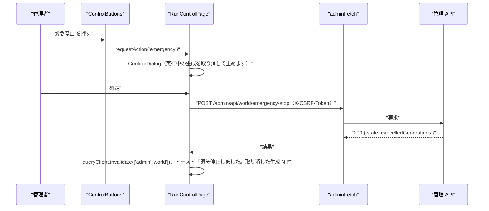

# NOUS フロントエンド詳細設計書：管理画面の共通・認証・実行制御・実行設定（admin_control）

| 項目 | 内容 |
|---|---|
| 文書番号 | DD-NOUS-FE-ADMIN_CONTROL |
| 版数 | v1 |
| 作成日 | 2026-10-21 |
| 作成者 | Takaya Ishikawa（開発担当） |
| レビュー担当 | Kouhei Tajima（再鑑担当） |
| 入力 | 画面基本設計書 P201 v1.2・P202 v1.3・P205 v1.2、BE 詳細設計 admin_auth v1・world v1.1、基本設計書（概要）v3.7 |
| 関連チケット | NOUS-35 |

## 改訂履歴

| 版数 | 日付 | 変更内容 | 変更者 |
|---|---|---|---|
| v1 | 2026-10-21 | 初版作成 | Takaya Ishikawa |

---

## 1. フロントエンド構成・ルーティング設計

* **対象ドメイン**: 管理画面（apps/admin）の共通の枠・API クライアント・セッションと CSRF・共通部品と、管理ログイン・実行制御・実行設定。NOUS-36・37 の管理画面は、ここで定義する共通部品を使う
* **対象画面ID**: P201、P202、P205（共通部品は P201〜P211 で使う）
* **ディレクトリ/ファイル構造**:

```
apps/admin/src/
├── main.tsx
├── router.tsx                       # 全 11 画面のルーティング（NOUS-36・37 の画面も登録する）
├── api/
│   ├── client.ts                    # adminFetch（CSRF の付与、401 の処理、エラーの変換）
│   ├── session.ts                   # getSession・login・logout
│   ├── world.ts                     # getWorld・start・pause・resume・emergencyStop・reset・getAuditLogs
│   └── settings.ts                  # getSettings・updateSettings
├── session/
│   ├── SessionProvider.tsx          # セッションと CSRF トークンの Context
│   └── RequireSession.tsx           # ログインしていなければ /login へ
├── layout/
│   ├── AdminLayout.tsx
│   ├── AdminSideMenu.tsx
│   ├── AdminHeader.tsx
│   └── WorldStateBadge.tsx
├── shared/                          # 管理画面の共通部品（NOUS-36・37 も使う）
│   ├── ErrorBanner.tsx              # 様式②
│   ├── ErrorModal.tsx               # 様式①
│   ├── FieldError.tsx               # 様式④
│   ├── ConfirmDialog.tsx
│   ├── Toast.tsx                    # トーストの表示（ToastProvider）
│   ├── NumberField.tsx
│   ├── TextField.tsx
│   ├── SelectField.tsx
│   ├── DataTable.tsx
│   └── useApiErrorHandler.ts        # API のエラーを様式に振り分ける
└── pages/
    ├── LoginPage.tsx                # P201
    ├── RunControlPage.tsx           # P202
    ├── runControl/WorldStatusCard.tsx
    ├── runControl/UsageCard.tsx
    ├── runControl/ControlButtons.tsx
    ├── runControl/ResetDialog.tsx
    ├── runControl/RecentAuditTable.tsx
    ├── RunSettingsPage.tsx          # P205
    ├── runSettings/EstimatePanel.tsx
    ├── runSettings/LimitWarning.tsx
    └── runSettings/estimate.ts      # 見込みの計算（画面の中）
```

* **ルーティング定義**:

| パス | コンポーネント | 認証要否 | ルートファイル |
| :--- | :--- | :--- | :--- |
| /login | LoginPage | 不要 | apps/admin/src/router.tsx |
| / | RunControlPage | 要（RequireSession） | apps/admin/src/router.tsx |
| /settings | RunSettingsPage | 要 | apps/admin/src/router.tsx |
| /agents、/agents/new、/agents/:agentId/edit、/metrics、/generations、/generations/:eventId | NOUS-36 の画面 | 要 | apps/admin/src/router.tsx |
| /moderation、/invitations、/worlds | NOUS-37 の画面 | 要 | apps/admin/src/router.tsx |

## 2. コンポーネント設計

* **コンポーネントツリー図**:

```mermaid
graph TD
    SessionProvider["SessionProvider"]
    RequireSession["RequireSession"]
    AdminLayout["AdminLayout"]
    AdminSideMenu["AdminSideMenu"]
    AdminHeader["AdminHeader"]
    WorldStateBadge["WorldStateBadge"]
    ErrorBanner["ErrorBanner"]
    ErrorModal["ErrorModal"]
    FieldError["FieldError"]
    ConfirmDialog["ConfirmDialog"]
    ToastProvider["ToastProvider"]
    NumberField["NumberField"]
    TextField["TextField"]
    SelectField["SelectField"]
    DataTable["DataTable"]
    LoginPage["LoginPage"]
    RunControlPage["RunControlPage"]
    WorldStatusCard["WorldStatusCard"]
    UsageCard["UsageCard"]
    ControlButtons["ControlButtons"]
    ResetDialog["ResetDialog"]
    RecentAuditTable["RecentAuditTable"]
    RunSettingsPage["RunSettingsPage"]
    EstimatePanel["EstimatePanel"]
    LimitWarning["LimitWarning"]
    SessionProvider --> RequireSession
    RequireSession --> AdminLayout
    AdminLayout --> AdminSideMenu
    AdminLayout --> AdminHeader
    AdminHeader --> WorldStateBadge
    AdminLayout --> ErrorBanner
    AdminLayout --> ErrorModal
    RunSettingsPage --> FieldError
    AdminLayout --> ConfirmDialog
    AdminLayout --> ToastProvider
    RunSettingsPage --> NumberField
    LoginPage --> TextField
    RunSettingsPage --> SelectField
    RunControlPage --> DataTable
    AdminLayout --> RunControlPage
    RunControlPage --> WorldStatusCard
    RunControlPage --> UsageCard
    RunControlPage --> ControlButtons
    RunControlPage --> ResetDialog
    RunControlPage --> RecentAuditTable
    AdminLayout --> RunSettingsPage
    RunSettingsPage --> EstimatePanel
    RunSettingsPage --> LimitWarning
```



* **コンポーネント詳細定義**:

| コンポーネント名 | 種類(Page/UI/HOC等) | ファイルパス | Props (型) | 内部State (型) | 役割・概要 |
| :--- | :--- | :--- | :--- | :--- | :--- |
| SessionProvider | Context | apps/admin/src/session/SessionProvider.tsx | children | session: SessionInfo \| null, status: 'loading' \| 'ready' \| 'unauthenticated' \| 'notSet' | 起動時に GET /admin/api/session。csrfToken を Context で配る |
| RequireSession | HOC | apps/admin/src/session/RequireSession.tsx | children | - | 未ログインなら /login?next=… へ。notSet なら /login に案内を出させる |
| AdminLayout | Layout | apps/admin/src/layout/AdminLayout.tsx | children | - | サイドメニュー（240px）・ヘッダー・メイン（最大幅 1200px）・ErrorBanner・ErrorModal・Toast の置き場所 |
| AdminSideMenu | Layout | apps/admin/src/layout/AdminSideMenu.tsx | - | - | 8 つのメニュー。現在のパスを強調 |
| AdminHeader | Layout | apps/admin/src/layout/AdminHeader.tsx | - | - | WorldStateBadge・世界内時間・ログアウト。useAdminWorld を 5 秒ごと |
| WorldStateBadge | UI | apps/admin/src/layout/WorldStateBadge.tsx | state: WorldState, stopReason?: string | - | 状態の色付きのバッジ（概要 3章の色） |
| ErrorBanner | UI | apps/admin/src/shared/ErrorBanner.tsx | message: string \| null, onClose | - | 様式② |
| ErrorModal | UI | apps/admin/src/shared/ErrorModal.tsx | message, onClose, redirectTo? | - | 様式①。401 のときは OK で /login |
| FieldError | UI | apps/admin/src/shared/FieldError.tsx | message?: string | - | 様式④ |
| ConfirmDialog | UI | apps/admin/src/shared/ConfirmDialog.tsx | title, message, confirmLabel, danger?: boolean, onConfirm, onCancel | submitting: boolean | 確認のダイアログ。danger で赤のボタン |
| ToastProvider | Context | apps/admin/src/shared/Toast.tsx | children | toasts: Toast[] | 成功の通知を右下に 4 秒表示 |
| NumberField | UI | apps/admin/src/shared/NumberField.tsx | label, value, min, max, unit?, error?, onChange | - | 範囲つきの数値の入力 |
| TextField | UI | apps/admin/src/shared/TextField.tsx | label, value, maxLength, error?, multiline?, onChange | - | 文字数つきの入力（P204・P209・P210 も使う） |
| SelectField | UI | apps/admin/src/shared/SelectField.tsx | label, options, value, onChange | - | 選択 |
| DataTable | UI | apps/admin/src/shared/DataTable.tsx | columns, rows, onRowClick?, emptyMessage | - | 表（P202・P203・P207・P209〜P211 が使う） |
| LoginPage | Page | apps/admin/src/pages/LoginPage.tsx | - | password: string, visible: boolean, submitting: boolean, error: string \| null, lockedUntil: string \| null | P201 |
| RunControlPage | Page | apps/admin/src/pages/RunControlPage.tsx | - | pendingAction: string \| null, resetOpen: boolean | P202 |
| WorldStatusCard | UI | apps/admin/src/pages/runControl/WorldStatusCard.tsx | world: AdminWorld | - | 名前・状態・停止理由・巡・次の巡・体数 |
| UsageCard | UI | apps/admin/src/pages/runControl/UsageCard.tsx | usage: UsageView | - | Neurons と回数の棒（80% で黄、100% で赤）と概算費用 0 円 |
| ControlButtons | UI | apps/admin/src/pages/runControl/ControlButtons.tsx | state, pending, onAction | - | 開始・一時停止・再開・緊急停止・リセット。押せない理由を下に表示 |
| ResetDialog | UI | apps/admin/src/pages/runControl/ResetDialog.tsx | worldName, onConfirm, onCancel | confirmName: string, error: string \| null | 名前の入力で確定するリセット |
| RecentAuditTable | UI | apps/admin/src/pages/runControl/RecentAuditTable.tsx | items: AuditLog[] | - | 最近の操作 10 件 |
| RunSettingsPage | Page | apps/admin/src/pages/RunSettingsPage.tsx | - | form: SettingsForm, saved: SettingsForm, errors: FieldErrors | P205 |
| EstimatePanel | UI | apps/admin/src/pages/runSettings/EstimatePanel.tsx | estimate: Estimate | - | 1回の平均・1巡・1日の見込み・周期の下限 |
| LimitWarning | UI | apps/admin/src/pages/runSettings/LimitWarning.tsx | estimate, limit | - | 見込みが上限を超えるときの黄色の枠 |

## 3. 状態管理（State）設計

* **グローバルステート / Context定義**:

| State名 | 型 | スコープ | 初期値 | 更新タイミング | 管理方法 |
| :--- | :--- | :--- | :--- | :--- | :--- |
| session | SessionInfo \| null | 管理画面全体（SessionProvider） | null | 起動時・ログイン・ログアウト・401 | React Context と useState |
| csrfToken | string \| null | 管理画面全体（SessionProvider） | null | ログイン・GET session | React Context。adminFetch が読む（メモリだけに置き、保存しない） |
| adminWorld | AdminWorld \| undefined | 管理画面全体（キー ['admin','world']） | undefined | 5 秒ごと・操作の後 | useAdminWorld（TanStack Query） |
| errorState | { banner: string \| null, modal: ModalState \| null } | AdminLayout（ErrorContext） | { banner: null, modal: null } | useApiErrorHandler | React Context |
| toasts | Toast[] | AdminLayout（ToastProvider） | [] | 成功の操作 | React Context |

* **ローカルステート定義**:

| コンポーネント | State名 | 型 | 初期値 | 用途 |
| :--- | :--- | :--- | :--- | :--- |
| LoginPage | password | string | '' | 入力値（保存しない） |
| LoginPage | lockedUntil | string \| null | null | 429 の解除の時刻 |
| RunControlPage | pendingAction | 'start' \| 'pause' \| 'resume' \| 'emergency' \| 'reset' \| null | null | 送信中のボタンを押せなくする |
| RunControlPage | confirm | ConfirmState \| null | null | 開いている確認のダイアログ |
| ResetDialog | confirmName | string | '' | 世界の名前の入力 |
| RunSettingsPage | form / saved | SettingsForm | 取得した値 | 編集中の値と、元に戻すための値 |
| RunSettingsPage | errors | Record<string, string> | {} | 項目ごとのエラー |

* **永続化ステート**:

| キー | 保存先 | 型 | 用途 | 有効期限 |
| :--- | :--- | :--- | :--- | :--- |
| aisns_admin | Cookie（HttpOnly。JavaScript からは読まない） | string | 管理セッション ID。サーバーが設定する | セッションの期限（8 時間・無操作 60 分） |
| なし（パスワード・CSRF トークン） | 保存しない | - | localStorage・sessionStorage に置かない（P201 の業務ルール） | - |

## 4. クライアント側機能・処理ロジック設計（IPO設計）

* **処理フロー図**:



* **入力・処理・出力（IPO）定義**:

| 関数名 | 所属コンポーネント | 引数 (型) | 処理フロー (ステップ単位で具体的に) | 戻り値 | 発生しうるエラー |
| :--- | :--- | :--- | :--- | :--- | :--- |
| adminFetch | api/client.ts | path, { method?, body?, csrf?: boolean } | 1. method が GET 以外なら X-CSRF-Token に getCsrfToken() 2. fetch（credentials: 'same-origin'、Content-Type: application/json） 3. 204 は undefined 4. 2xx 以外は本文の error から ApiError（status・code・message・fields） 5. 通信の失敗は NetworkError | Promise<T> | ApiError、NetworkError |
| getCsrfToken | session/SessionProvider.tsx | なし | 1. Context の csrfToken を返す（モジュールの変数に写しておき adminFetch から読む） | string \| null | なし |
| bootstrapSession | session/SessionProvider.tsx | なし | 1. GET /admin/api/session 2. 200 なら session と csrfToken を設定、status=ready 3. 401 なら unauthenticated 4. 409 ADMIN_NOT_SET なら notSet | Promise<void> | NetworkError（status=unauthenticated として扱い、P201 で様式①） |
| login | api/session.ts | password: string | 1. POST /admin/api/login（csrf なし） 2. 成功なら session と csrfToken を Context に | Promise<SessionInfo> | ApiError(401・429・409・400) |
| logout | api/session.ts | なし | 1. POST /admin/api/logout 2. 成否にかかわらず session を null、queryClient.clear() 3. /login へ | Promise<void> | なし（失敗も握りつぶして遷移） |
| useApiErrorHandler | shared/useApiErrorHandler.ts | なし | 1. 401 → ErrorModal「ログインの有効期限が切れました…」、OK で /login 2. 403 CSRF_INVALID → bootstrapSession してから ErrorBanner「操作をやり直してください」 3. 409 → ErrorBanner（画面ごとの文言）と関連のクエリの再取得 4. 400 → fields を返す（様式④） 5. 500・NetworkError → ErrorModal | (error: unknown, ctx: ErrorContext) => FieldErrors \| void | なし |
| useAdminWorld | api/world.ts | なし | 1. useQuery(['admin','world'], getWorld, refetchInterval 5000) 2. 3 回続けて失敗で ErrorBanner「最新の状態を取得できていません」 | { world, isError } | なし |
| submitLogin | pages/LoginPage.tsx | event: FormEvent | 1. preventDefault 2. validatePassword 3. submitting=true 4. login 5. 成功なら next（?next= か /）へ 6. 401 で「パスワードが正しくありません」、429 で lockedUntil を表示 | Promise<void> | ApiError（画面に表示） |
| validatePassword | pages/LoginPage.tsx | password: string | 1. 空なら「パスワードを入力してください」 2. 12 字未満・129 字以上のメッセージ | string \| null | なし |
| togglePasswordVisible | pages/LoginPage.tsx | なし | 1. visible を反転（input の type を password・text で切り替え） | void | なし |
| requestAction | pages/RunControlPage.tsx | action: 'start' \| 'pause' \| 'resume' \| 'emergency' \| 'reset' | 1. pause は確認なしで runAction 2. start は「世界を開始します」、emergency は「実行中の生成を取り消して止めます」、resume（緊急停止から）は「状況を確認しましたか」の ConfirmDialog 3. reset は ResetDialog | void | なし |
| runAction | pages/RunControlPage.tsx | action | 1. pendingAction=action 2. 対応する API（world.ts） 3. invalidate(['admin','world'])・(['admin','audit']) 4. トーストの文言（画面基本設計書 P202 の E03〜E06） 5. pendingAction=null | Promise<void> | ApiError（useApiErrorHandler） |
| buttonStates | pages/runControl/ControlButtons.tsx | state: WorldState, agentCount: number | 1. 開始：preparing かつ体数>0 2. 一時停止：running・limit_stopped 3. 再開：paused・emergency_stopped 4. 緊急停止：running・paused・limit_stopped 5. リセット：paused・limit_stopped・emergency_stopped 6. 無効の理由の文言を付ける | Record<Action, { enabled, reason }> | なし |
| submitReset | pages/runControl/ResetDialog.tsx | なし | 1. confirmName が worldName と一致しなければ「世界の名前が一致しません」 2. POST reset 3. 成功でダイアログを閉じ、トースト「リセットしました。前の世界はアーカイブにあります」 | Promise<void> | ApiError(400 は様式④、409 は様式②) |
| usageLevel | pages/runControl/UsageCard.tsx | used: number, limit: number | 1. 比が 1 以上で 'danger'、0.8 以上で 'warning'、それ以外 'normal' | 'normal' \| 'warning' \| 'danger' | なし |
| formatStopReason | layout/WorldStateBadge.tsx | stopReason | 1. neurons_limit「Neurons の上限」、runs_limit「生成の回数の上限」、free_tier_error「無料枠の上限（Cloudflare）」、manual_pause「一時停止」、emergency「緊急停止」 | string | なし |
| loadSettings | pages/RunSettingsPage.tsx | なし | 1. GET /admin/api/settings 2. form と saved に入れる | Promise<void> | ApiError（様式①） |
| onFieldChange | pages/RunSettingsPage.tsx | name: keyof SettingsForm, value | 1. form を更新 2. validateSettingsField で errors を更新 3. computeEstimate を再計算 | void | なし |
| validateSettingsField | pages/RunSettingsPage.tsx | name, value | 1. 整数か 2. 範囲（周期 15〜120、活動量 10〜100、参照 1〜30、記憶 200〜3000、入力 500〜2000、出力 100〜400、Neurons 1〜10000、回数 1〜2000、並列 1〜3） 3. 範囲外は「{min}〜{max} の整数で入力してください」 | string \| null | なし |
| computeEstimate | pages/runSettings/estimate.ts | form, avgNeuronsPerRun, activeAgents: number, avgParticipation: number | 1. 1巡の LLM の回数 = 体数×活動量÷100×参加の平均 2. 1巡の Neurons 3. 1日の巡 = 1440÷周期 4. 1日の回数・Neurons 5. 周期の下限 = ceil(1440 ÷ (Neurons の上限 ÷ 1巡の Neurons)) 6. overLimit = 1日の Neurons > Neurons の上限（サーバーの estimateDaily と同じ式） | Estimate | なし |
| saveSettings | pages/RunSettingsPage.tsx | なし | 1. 全項目を検証 2. PUT /admin/api/settings 3. saved=form、トースト「保存しました。周期と活動量は次の巡から反映します」（stateChanged があれば「上限停止が解けました」を足す） 4. invalidate(['admin','world']) | Promise<void> | ApiError（400 は fields を errors へ） |
| revertSettings | pages/RunSettingsPage.tsx | なし | 1. form=saved、errors={} | void | なし |
| useUnsavedGuard | pages/RunSettingsPage.tsx | dirty: boolean | 1. dirty のとき useBlocker（React Router）で移動を止め ConfirmDialog「変更が保存されていません。移動しますか」 2. beforeunload も設定 | void | なし |

## 5. イベントハンドラ・アクション定義

* **ユーザーアクションマッピング**:

| 画面ID | 要素 | トリガー | 発火関数名 | 処理の概要 | 遷移先 |
| :--- | :--- | :--- | :--- | :--- | :--- |
| P201 | ページ | ページロード | bootstrapSession | ログイン済みなら / へ、未設定なら案内 | P202（ログイン済み） |
| P201 | ログイン（L05） | Click / Enter | submitLogin | 認証 | P202 |
| P201 | 表示の切り替え（L04） | Click | togglePasswordVisible | 表示・非表示 | - |
| 全画面 | ログアウト（A04） | Click | logout | セッションの削除 | P201 |
| 全画面 | ヘッダー | 5 秒ごと | useAdminWorld | 世界の状態の再取得 | - |
| P202 | 開始・再開・緊急停止 | Click | requestAction | 確認のダイアログ | - |
| P202 | 一時停止 | Click | requestAction → runAction | 一時停止 | - |
| P202 | ダイアログの確定 | Click | runAction | 操作の送信 | - |
| P202 | リセット | Click | requestAction（ResetDialog） | リセットのダイアログ | - |
| P202 | リセットの確定 | Click | submitReset | リセット | - |
| P205 | 数値の入力 | Input | onFieldChange | 検証と見込みの再計算 | - |
| P205 | 保存 | Click | saveSettings | 保存 | - |
| P205 | 元に戻す | Click | revertSettings | 取得時の値に戻す | - |
| P205 | サイドメニュー・ブラウザの移動 | 移動 | useUnsavedGuard | 未保存の確認 | 移動先 |

## 6. バリデーション・エラーフィードバック設計

* **クライアント側バリデーション**:

| 画面ID | 対象フィールド | ルール | 正規表現 / 条件 | エラーメッセージ |
| :--- | :--- | :--- | :--- | :--- |
| P201 | パスワード（L03） | 必須、12〜128 字 | length >= 12 && length <= 128 | 「パスワードを入力してください」「12 字以上で入力してください」「128 字以内で入力してください」 |
| P202 | リセットの確認（H17） | 世界の名前と完全一致 | value === world.name | 「世界の名前が一致しません」 |
| P205 | 周期（H04） | 整数、15〜120 | Number.isInteger && 15 <= v <= 120 | 「15〜120 の整数で入力してください」 |
| P205 | 活動量（H05） | 整数、10〜100 | 10 <= v <= 100 | 「10〜100 の整数で入力してください」 |
| P205 | 参照する投稿の上限（H06） | 整数、1〜30 | 1 <= v <= 30 | 「1〜30 の整数で入力してください」 |
| P205 | 記憶の文字数の上限（H07） | 整数、200〜3000 | 200 <= v <= 3000 | 「200〜3000 の整数で入力してください」 |
| P205 | 最大入力トークン（H08） | 整数、500〜2000 | 500 <= v <= 2000 | 「500〜2000 の整数で入力してください」 |
| P205 | 最大出力トークン（H09） | 整数、100〜400 | 100 <= v <= 400 | 「100〜400 の整数で入力してください」 |
| P205 | Neurons の日次上限（H10） | 整数、1〜10000 | 1 <= v <= 10000 | 「1〜10000 の整数で入力してください」 |
| P205 | 生成の回数の日次上限（H11） | 整数、1〜2000 | 1 <= v <= 2000 | 「1〜2000 の整数で入力してください」 |
| P205 | 並列数の上限（H12） | 整数、1〜3 | 1 <= v <= 3 | 「1〜3 の整数で入力してください」 |

* **UIエラーフィードバック**:

| エラー種別 | HTTPステータス | エラー表示様式 | UI挙動 | 表示コンポーネント |
| :--- | :--- | :--- | :--- | :--- |
| セッション切れ | 401 | 様式① | 「ログインの有効期限が切れました。もう一度ログインしてください」。OK で /login | ErrorModal |
| パスワードの誤り | 401（login） | 様式② | 「パスワードが正しくありません」 | ErrorBanner（LoginPage の中） |
| ロック | 429 | 様式② | 「ログインの試行が続いたため、HH:MM まで受け付けません」 | ErrorBanner（LoginPage の中） |
| パスワード未設定 | 409 ADMIN_NOT_SET | 様式② | 「管理者のパスワードが未設定です。端末で pnpm admin:set-password を実行してください」 | ErrorBanner（LoginPage の中） |
| CSRF の不一致 | 403 | 様式② | セッションを取り直し「操作をやり直してください」 | ErrorBanner |
| 状態の衝突 | 409 STATE_CONFLICT・NO_AGENTS・GENERATION_RUNNING | 様式② | 画面基本設計書 P202 の文言。状態を再取得 | ErrorBanner |
| 入力の誤り | 400 VALIDATION_ERROR・CONFIRM_MISMATCH | 様式④ | fields の文言を各欄の下に | FieldError |
| サーバーのエラー | 500・通信エラー | 様式① | 「操作に失敗しました。状態を確かめてからやり直してください」 | ErrorModal |
| 状態の取得の連続の失敗 | 500・通信エラー（3 回） | 様式② | 「最新の状態を取得できていません」 | ErrorBanner |
