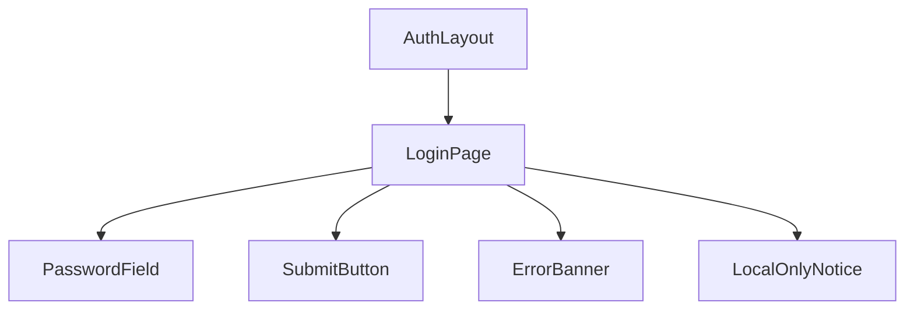

# P201 管理ログイン

| 項目 | 内容 |
| :--- | :--- |
| 文書番号 | BD-NOUS-SC-P201 |
| 版数 | v1.2（サービス名を NOUS に変更。NOUS-26） |
| 作成者 | Takaya Ishikawa（開発担当） |
| レビュー担当 | Kouhei Tajima（再鑑担当） |
| 関連チケット | NOUS-24 |

## 1. 画面概要

| 項目 | 内容 |
| :--- | :--- |
| 画面ID | P201 |
| 画面名 | 管理ログイン |
| パス | /login（管理サーバー 127.0.0.1:8081） |
| 概要 | 管理者がパスワードで認証する。5 回続けて失敗すると 15 分受け付けない。管理サーバーは端末からだけ接続できる。 |
| アクター | 管理者（Kaine Yamashiro） |
| 認証要否 | 不要（この画面で認証する） |
| 前画面 | 管理画面のどの画面（セッション切れ）、ブラウザで http://127.0.0.1:8081/ を開いたとき |
| 後画面 | P202 |
| 対応ソースファイル | apps/admin/src/pages/LoginPage.tsx |
| カラーテーマ | 管理（サイドメニュー #1E293B、背景 #F1F5F9。基本設計書（概要）3章） |
| 対応する要件 | SC-201、FR-407、NFR-S-004、NFR-S-007 |

## 2. ワイヤーフレーム

### 2.1 ワイヤーフレーム（モバイル）

該当なし。管理画面は管理者の端末（PC）だけを対象とし、最小幅 1024px で設計する（基本設計書（概要）3章）。

### 2.2 ワイヤーフレーム（デスクトップ）（該当する場合のみ）

### 2.3 画面レイアウト説明

サイドメニューを出さず、画面中央に幅 400px のログインの枠を置く。枠の中に見出し・パスワードの入力欄・ログインのボタン・注意書きを縦に並べる。

## 3. UI構成・コンポーネント定義

### 3.1 コンポーネントツリー

### 3.2 コンポーネント一覧

| コンポーネントID | コンポーネント名 | 種別 | Props | 内部State | 役割・概要 |
| :--- | :--- | :--- | :--- | :--- | :--- |
| C01 | AuthLayout | Layout | children | - | サイドメニューのない中央寄せの枠 |
| C02 | LoginPage | Page | - | password (string)、submitting (boolean)、error (string) | ログインの送信と結果の処理 |
| C03 | PasswordField | UI | value、onChange、error | visible (boolean) | パスワードの入力欄と表示の切り替え |
| C04 | SubmitButton | UI | disabled、loading | - | ログインのボタン |
| C05 | ErrorBanner | UI | message | - | 様式②の赤色バー（認証の失敗・ロック） |
| C06 | LocalOnlyNotice | UI | - | - | 端末からだけ開けることの注意書き |

## 4. 画面項目定義

| 項目ID | 項目名 | 種別 | 必須 | データ型 | 制約・初期値 | 表示条件 | 備考 |
| :--- | :--- | :--- | :--- | :--- | :--- | :--- | :--- |
| L01 | サービス名 | 表示 | - | string | 「NOUS 管理」固定 | 常時 | - |
| L02 | 見出し | 表示 | - | string | 「管理ログイン」固定 | 常時 | - |
| L03 | パスワード | 入力 | 必須 | string | 12〜128 字。type=password。初期値は空 | 常時 | autocomplete=current-password |
| L04 | パスワードの表示の切り替え | ボタン | - | boolean | 目のアイコン。初期は非表示 | 常時 | 押すと type=text と切り替え |
| L05 | ログイン | ボタン | - | - | 固定文言 | 常時 | 送信中は「確認中…」で押せない |
| L06 | 注意書き | 表示 | - | string | 「この画面は、システムを動かす端末からだけ開けます」固定 | 常時 | NFR-S-007 |
| L07 | 認証の失敗の表示 | 表示 | - | string | 「パスワードが正しくありません」 | 401 LOGIN_FAILED のとき | 様式② |
| L08 | ロックの表示 | 表示 | - | string | 「ログインの試行が続いたため、HH:MM まで受け付けません」 | 429 LOGIN_LOCKED のとき | 解除の時刻を表示 |
| L09 | 残りの試行の回数 | 表示 | - | number | 「あと N 回失敗すると 15 分ロックされます」 | 失敗が 3 回以上のとき | N=5−失敗回数 |
| L10 | 入力欄のエラー | 表示 | - | string | 様式④の文言 | 検証に失敗したとき | - |
| L11 | セッション切れの案内 | 表示 | - | string | 「ログインの有効期限が切れました」 | ?expired=1 で来たとき | 様式②の色で表示 |
| L12 | ページのタイトル | 表示 | - | string | 「管理ログイン - NOUS」 | 常時 | ブラウザのタブ |
| L13 | フォーカス | 表示 | - | - | ページロードでパスワードの入力欄にフォーカス | 常時 | - |
| L14 | Enter キー | 表示 | - | - | パスワードの入力欄で Enter を押すと送信 | 常時 | - |
| L15 | パスワード未設定の案内 | 表示 | - | string | 「管理者のパスワードが未設定です。端末で pnpm admin:set-password を実行してください」 | GET /admin/api/session が 409 ADMIN_NOT_SET のとき | - |

## 5. イベント定義

| イベントID | 発生源 | トリガー | 条件 | 処理概要 | 呼び出しAPI | 成功時の挙動 | 失敗時の挙動（様式ID + 説明） |
| :--- | :--- | :--- | :--- | :--- | :--- | :--- | :--- |
| E01 | ページ | ページロード | 画面遷移時 | セッションが有効なら P202 へ移る。パスワードが未設定なら案内を出す | GET /admin/api/session | 有効なら P202。無効ならフォームを表示 | 様式①: 500 で「管理サーバーに接続できません」 |
| E02 | ログイン（L05） | Click / Enter | L03 が検証に通る | パスワードを送信する | POST /admin/api/login | CSRF トークンを保持して P202 へ遷移 | 様式②: 401 で「パスワードが正しくありません」、429 でロックの表示。様式①: 500 |
| E03 | パスワード（L03） | Input | 常時 | 入力値を保持し、エラーを消す | なし | L10 を消す | 該当なし |
| E04 | 表示の切り替え（L04） | Click | 常時 | 表示・非表示を切り替える | なし | 入力欄の type を変える | 該当なし |
| E05 | ログイン（L05） | Click | L03 が 12 字未満 | 送信せずに検証のエラーを出す | なし | - | 様式④: 「12 字以上で入力してください」 |

### 5.1 エラー表示様式定義

| 様式ID | 様式名 | 表示方法 | 使用コンポーネント | 使用場面 | ユーザー操作 |
| :--- | :--- | :--- | :--- | :--- | :--- |
| 様式① | ポップアップ表示 | モーダルダイアログで画面中央にエラーメッセージを表示 | ErrorModal | 管理サーバーのエラー（500）・通信エラー | OK で閉じる |
| 様式② | 画面上部表示 | 画面上部（ヘッダー直下）に赤色バーでメッセージを表示 | ErrorBanner | 認証の失敗（401）とロック（429） | 入力し直す、または解除の時刻を待つ |
| 様式③ | 全画面エラー | 該当なし | 該当なし | 該当なし | 該当なし |
| 様式④ | 入力欄下表示 | 対象の入力フィールド直下に赤文字でインラインエラーを表示 | FieldError | パスワードの文字数の不足・超過 | 入力を直すと消える |

**この画面で使用するエラー様式の詳細**:

| 様式ID | エラー発生条件 | エラーメッセージ文言 | 補足（遷移先・復帰手順） |
| :--- | :--- | :--- | :--- |
| 様式① | POST /admin/api/login が 500、または通信できない | 「管理サーバーに接続できません。システムが起動しているか確かめてください」 | OK で閉じる |
| 様式② | 401 LOGIN_FAILED | 「パスワードが正しくありません」 | 入力し直す |
| 様式② | 429 LOGIN_LOCKED | 「ログインの試行が続いたため、HH:MM まで受け付けません」 | 解除の時刻まで待つ |
| 様式④ | 12 字未満で送信 | 「12 字以上で入力してください」 | 入力すると消える |
| 様式④ | 129 字以上を入力 | 「128 字以内で入力してください」 | 入力すると消える |

## 6. バリデーション・制約定義

| 対象項目ID | 項目名 | ルール | エラーメッセージ |
| :--- | :--- | :--- | :--- |
| L03 | パスワード | 必須。12〜128 字 | 「パスワードを入力してください」「12 字以上で入力してください」「128 字以内で入力してください」 |

## 7. 画面固有の業務ルール・注意事項

* パスワードは画面の状態にだけ持ち、localStorage・sessionStorage に保存しない
* 認証の失敗は、5 回続くと 15 分ロックする（サーバーで判定）
* 管理サーバーは 127.0.0.1 だけで待ち受けるため、他の端末からはこの画面も開けない（NFR-S-007）
* ログインの成功・失敗は管理操作履歴に残す（admin.login・admin.login_failed）
