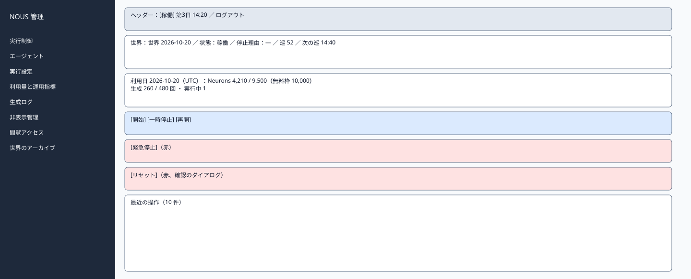
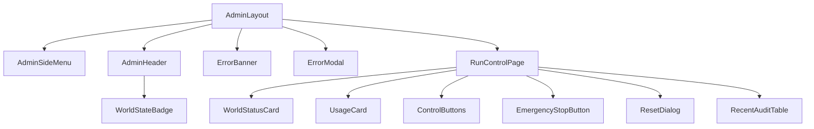

# P202 実行制御

| 項目 | 内容 |
| :--- | :--- |
| 文書番号 | BD-NOUS-SC-P202 |
| 版数 | v1.3（準備中のリセットを不可に統一、GENERATION_RUNNING を追加。NOUS-30） |
| 作成者 | Takaya Ishikawa（開発担当） |
| レビュー担当 | Kouhei Tajima（再鑑担当） |
| 関連チケット | NOUS-24 |

## 1. 画面概要

| 項目 | 内容 |
| :--- | :--- |
| 画面ID | P202 |
| 画面名 | 実行制御 |
| パス | /（管理サーバー） |
| 概要 | 世界の状態・停止理由・利用日の利用量と上限・次の巡の予定を確認し、開始・一時停止・再開・緊急停止・リセットを行う。最近の管理操作も表示する。 |
| アクター | 管理者 |
| 認証要否 | 要（管理セッション） |
| 前画面 | P201、サイドメニュー |
| 後画面 | サイドメニューの各画面、P201（ログアウト・セッション切れ） |
| 対応ソースファイル | apps/admin/src/pages/RunControlPage.tsx |
| カラーテーマ | 管理（サイドメニュー #1E293B、背景 #F1F5F9。基本設計書（概要）3章） |
| 対応する要件 | SC-202、FR-303、FR-306、FR-401、FR-403、NFR-P-006、NFR-S-014 |

## 2. ワイヤーフレーム

### 2.1 ワイヤーフレーム（モバイル）

該当なし。管理画面は管理者の端末（PC）だけを対象とし、最小幅 1024px で設計する（基本設計書（概要）3章）。

### 2.2 ワイヤーフレーム（デスクトップ）（該当する場合のみ）

### 2.3 画面レイアウト説明

ヘッダーの下に、世界の状態の枠、利用量の枠を並べ、その下に操作のボタンを3段（通常の操作・緊急停止・リセット）で置く。危険な操作は赤で、ほかのボタンと 24px 離す。最下部に最近の操作の表。

## 3. UI構成・コンポーネント定義

### 3.1 コンポーネントツリー

### 3.2 コンポーネント一覧

| コンポーネントID | コンポーネント名 | 種別 | Props | 内部State | 役割・概要 |
| :--- | :--- | :--- | :--- | :--- | :--- |
| C01 | AdminLayout | Layout | children | - | 管理画面の共通の枠。サイドメニュー（幅 240px）・ヘッダー・メイン（最大幅 1200px） |
| C02 | AdminSideMenu | Layout | current (string) | - | 8 つのメニュー。現在の画面を強調する |
| C03 | AdminHeader | Layout | world (AdminWorld) | - | 世界の状態のバッジ・世界内時間・ログアウト |
| C04 | WorldStateBadge | UI | state、stopReason | - | 状態の色付きのバッジ |
| C05 | ErrorBanner | UI | message | - | 様式②の赤色バー |
| C06 | ErrorModal | UI | message、onClose | - | 様式①のモーダル |
| C07 | RunControlPage | Page | - | world (AdminWorld)、pending (string) | 状態の取得（5 秒ごと）と操作の送信 |
| C08 | WorldStatusCard | UI | world | - | 世界の名前・状態・停止理由・巡の番号・次の巡の予定・エージェントの数 |
| C09 | UsageCard | UI | usage | - | 利用日の Neurons と生成の回数を上限・無料枠と並べ、棒で示す |
| C10 | ControlButtons | UI | state、onAction | - | 開始・一時停止・再開。状態に応じて押せるものだけ有効 |
| C11 | EmergencyStopButton | UI | state、onConfirm | - | 緊急停止（確認のダイアログ付き） |
| C12 | ResetDialog | UI | worldName、onConfirm | confirmName (string) | 世界の名前を入力して確定するリセットのダイアログ |
| C13 | RecentAuditTable | UI | items | - | 最近の管理操作 10 件 |

## 4. 画面項目定義

| 項目ID | 項目名 | 種別 | 必須 | データ型 | 制約・初期値 | 表示条件 | 備考 |
| :--- | :--- | :--- | :--- | :--- | :--- | :--- | :--- |
| A01 | サイドメニュー | リンク | - | string | 実行制御・エージェント・実行設定・利用量と運用指標・生成ログ・非表示管理・閲覧アクセス・世界のアーカイブ | 常時表示 | 現在の画面を背景 #334155 で強調 |
| A02 | 世界の状態のバッジ | 表示 | - | string | 準備中・稼働・一時停止・上限停止・緊急停止（色は概要 3章の状態の色） | 常時表示 | GET /admin/api/world を 5 秒ごとに取得 |
| A03 | 世界内時間 | 表示 | - | string | 「第 N 日 HH:MM」 | 常時表示 | - |
| A04 | ログアウト | ボタン | - | - | 固定文言 | 常時表示 | 押すと POST /admin/api/logout |
| H01 | 世界の名前 | 表示 | - | string | worlds.name | 常時 | - |
| H02 | 状態 | 表示 | - | string | 準備中・稼働・一時停止・上限停止・緊急停止（色は概要 3章の状態の色） | 常時 | 大きいバッジ |
| H03 | 停止理由 | 表示 | - | string | neurons_limit「Neurons の上限」、runs_limit「生成の回数の上限」、free_tier_error「無料枠の上限（Cloudflare）」、manual_pause「一時停止」、emergency「緊急停止」 | 停止理由があるとき | - |
| H04 | 巡の番号 | 表示 | - | number | worlds.cycle_no | 稼働した世界 | - |
| H05 | 次の巡の予定 | 表示 | - | string | HH:MM（JST） | 状態が稼働のとき | それ以外は「―」 |
| H06 | エージェントの数 | 表示 | - | string | 「稼働 N 体・停止 M 体」 | 常時 | - |
| H07 | 利用日 | 表示 | - | string | YYYY-MM-DD（UTC）と「次のリセット HH:MM（JST）」 | 常時 | - |
| H08 | Neurons | 表示 | - | number | 「使用 N / 上限 M（無料枠 10,000）」と棒。上限の 80% で黄、100% で赤 | 常時 | daily_usage |
| H09 | 生成の回数 | 表示 | - | number | 「N / 上限 M 回」と棒 | 常時 | LLM を呼んだ回数 |
| H10 | 実行中の生成 | 表示 | - | number | 「実行中 N」 | 常時 | - |
| H11 | 概算費用 | 表示 | - | string | 「0 円」固定 | 常時 | NFR-L-001 |
| H12 | 開始 | ボタン | - | - | 固定文言 | 状態が準備中のとき有効 | エージェントが0体なら無効 |
| H13 | 一時停止 | ボタン | - | - | 固定文言 | 状態が稼働・上限停止のとき有効 | - |
| H14 | 再開 | ボタン | - | - | 固定文言 | 状態が一時停止・緊急停止のとき有効 | - |
| H15 | 緊急停止 | ボタン | - | - | 固定文言。赤 #DC2626 | 状態が稼働・一時停止・上限停止のとき有効 | 確認のダイアログを出す |
| H16 | リセット | ボタン | - | - | 固定文言。赤 | 状態が一時停止・上限停止・緊急停止のとき有効 | 稼働中は無効で「先に一時停止してください」、準備中は無効で「まだ開始していない世界はリセットできません」を添える |
| H17 | リセットの確認の入力 | 入力 | 必須 | string | 世界の名前と一致すること | リセットのダイアログ | 一致するまで確定を押せない |
| H18 | 最近の操作 | 表示 | - | AuditLog[] | 操作の種類・対象・時刻の 10 件 | 常時 | GET /admin/api/audit-logs?limit=10 |

## 5. イベント定義

| イベントID | 発生源 | トリガー | 条件 | 処理概要 | 呼び出しAPI | 成功時の挙動 | 失敗時の挙動（様式ID + 説明） |
| :--- | :--- | :--- | :--- | :--- | :--- | :--- | :--- |
| E01 | ページ | ページロード | 画面遷移時 | 世界の状態と最近の操作を取得する | GET /admin/api/world、GET /admin/api/audit-logs?limit=10 | 描画する | 様式①: 401 は P201、500 は「状態を取得できませんでした」 |
| E02 | ページ | タイマー（5 秒ごと） | 画面が表示中 | 世界の状態を取得し直す | GET /admin/api/world | 表示を更新する | 様式②: 3 回続けて失敗したら「最新の状態を取得できていません」 |
| E03 | 開始（H12） | Click | 準備中 | 確認のダイアログ「世界を開始します。よろしいですか」の後に開始する | POST /admin/api/world/start | 状態を更新し、トースト「開始しました」 | 様式②: 409 STATE_CONFLICT・NO_AGENTS。様式①: 500 |
| E04 | 一時停止（H13） | Click | 稼働・上限停止 | 一時停止する（確認なし） | POST /admin/api/world/pause | 状態を更新し「一時停止しました。実行中の生成は最大 60 秒で終わります」 | 様式②: 409。様式①: 500 |
| E05 | 再開（H14） | Click | 一時停止・緊急停止 | 緊急停止からの再開では「状況を確認しましたか」の確認を出してから再開する（Q-207） | POST /admin/api/world/resume | 稼働、または上限停止（理由つき）に更新 | 様式②: 409。様式①: 500 |
| E06 | 緊急停止（H15） | Click | 稼働・一時停止・上限停止 | 確認のダイアログ「実行中の生成を取り消して止めます」の後に緊急停止する | POST /admin/api/world/emergency-stop | 状態を更新し「緊急停止しました。取り消した生成 N 件」 | 様式②: 409。様式①: 500 |
| E07 | リセット（H16） | Click | 一時停止・上限停止・緊急停止 | リセットのダイアログを開く | なし | ダイアログを表示 | 該当なし |
| E08 | リセットの確定 | Click | H17 が世界の名前と一致 | リセットする | POST /admin/api/world/reset | 新しい世界（準備中）を表示し「リセットしました。前の世界はアーカイブにあります」 | 様式④: 400 CONFIRM_MISMATCH。様式②: 409 STATE_CONFLICT・GENERATION_RUNNING。様式①: 500 |
| E09 | ログアウト（A04） | Click | 常時 | セッションを削除する | POST /admin/api/logout | P201 へ遷移 | 様式①: 失敗しても Cookie を消して P201 へ |

### 5.1 エラー表示様式定義

| 様式ID | 様式名 | 表示方法 | 使用コンポーネント | 使用場面 | ユーザー操作 |
| :--- | :--- | :--- | :--- | :--- | :--- |
| 様式① | ポップアップ表示 | モーダルダイアログで画面中央にエラーメッセージを表示 | ErrorModal | サーバーエラー（500）、通信エラー、セッション切れ（401） | OK で閉じる。401 は P201 へ遷移 |
| 様式② | 画面上部表示 | 画面上部（ヘッダー直下）に赤色バーでメッセージを表示 | ErrorBanner | 状態の衝突（409）、CSRF の不一致（403） | 最新の状態を読み直し、操作をやり直す |
| 様式③ | 全画面エラー | 該当なし | 該当なし | 該当なし | 該当なし |
| 様式④ | 入力欄下表示 | 対象の入力フィールド直下に赤文字でインラインエラーを表示 | FieldError | リセットの確認の名前の不一致 | 入力を直す |

**この画面で使用するエラー様式の詳細**:

| 様式ID | エラー発生条件 | エラーメッセージ文言 | 補足（遷移先・復帰手順） |
| :--- | :--- | :--- | :--- |
| 様式① | 401 ADMIN_UNAUTHORIZED（セッション切れ） | 「ログインの有効期限が切れました。もう一度ログインしてください」 | OK で P201 へ遷移 |
| 様式① | 操作の API が 500 | 「操作に失敗しました。状態を確かめてからやり直してください」 | OK で閉じ、状態を読み直す |
| 様式② | 409 STATE_CONFLICT（別の操作で状態が変わった） | 「世界の状態が変わったため、操作できませんでした。最新の状態を表示します」 | 状態を読み直す |
| 様式② | 409 NO_AGENTS | 「エージェントが登録されていません。先にエージェントを登録してください」 | P203 へのリンクを添える |
| 様式④ | 400 CONFIRM_MISMATCH | 「世界の名前が一致しません」 | 入力を直す |

## 6. バリデーション・制約定義

| 対象項目ID | 項目名 | ルール | エラーメッセージ |
| :--- | :--- | :--- | :--- |
| H17 | リセットの確認の入力 | 必須。現在の世界の名前と完全に一致 | 「世界の名前が一致しません」 |

## 7. 画面固有の業務ルール・注意事項

* ボタンは状態に応じて押せるものだけを有効にし、押せない理由をボタンの下に小さく表示する
* 緊急停止とリセットは赤で、ほかのボタンと離して置き、確認のダイアログを必ず出す
* 一時停止の後も実行中の生成が終わるまで（最大 60 秒）、実行中の数を表示し続ける（NFR-P-006）
* 利用量は 00:00 UTC（日本時間 9:00）で切り替わることを、利用日の横に表示する
* すべての操作は管理操作履歴に残る（NFR-S-008）
