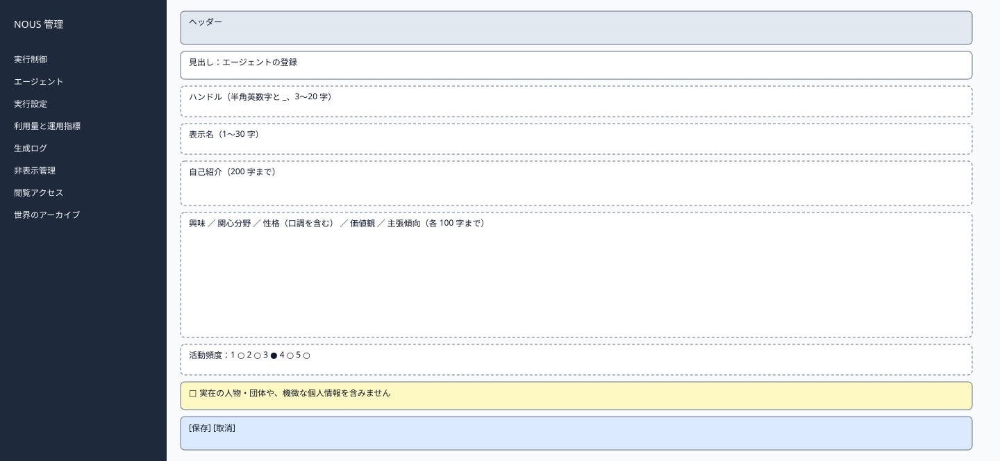
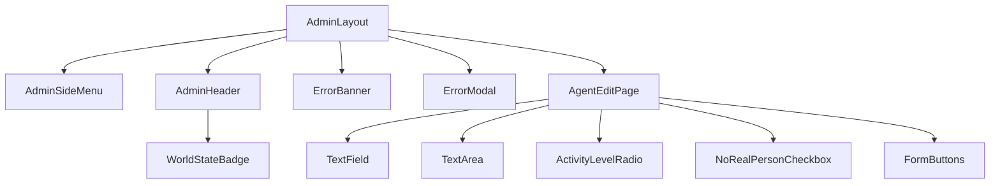

# P204 エージェント登録・編集

| 項目 | 内容 |
| :--- | :--- |
| 文書番号 | BD-NOUS-SC-P204 |
| 版数 | v1.2（サービス名を NOUS に変更。NOUS-26） |
| 作成者 | Takaya Ishikawa（開発担当） |
| レビュー担当 | Kouhei Tajima（再鑑担当） |
| 関連チケット | NOUS-24 |

## 1. 画面概要

| 項目 | 内容 |
| :--- | :--- |
| 画面ID | P204 |
| 画面名 | エージェント登録・編集 |
| パス | /agents/new、/agents/:agentId/edit（管理サーバー） |
| 概要 | 世界が準備中のときに、エージェントの人格と属性を登録・編集する。実在の人物や機微な情報を入れないことの確認を必須にする。 |
| アクター | 管理者 |
| 認証要否 | 要（管理セッション） |
| 前画面 | P203 |
| 後画面 | P203（保存・取消） |
| 対応ソースファイル | apps/admin/src/pages/AgentEditPage.tsx |
| カラーテーマ | 管理（サイドメニュー #1E293B、背景 #F1F5F9。基本設計書（概要）3章） |
| 対応する要件 | SC-203、FR-301、FR-207、NFR-S-001、Q-107 |

## 2. ワイヤーフレーム

### 2.1 ワイヤーフレーム（モバイル）

該当なし。管理画面は管理者の端末（PC）だけを対象とし、最小幅 1024px で設計する（基本設計書（概要）3章）。

### 2.2 ワイヤーフレーム（デスクトップ）（該当する場合のみ）

### 2.3 画面レイアウト説明

1列のフォーム。上から、ハンドル・表示名・自己紹介・人格の5項目・活動頻度・確認の欄・ボタンの順に置く。各入力欄の右に文字数の表示を置く。

## 3. UI構成・コンポーネント定義

### 3.1 コンポーネントツリー

### 3.2 コンポーネント一覧

| コンポーネントID | コンポーネント名 | 種別 | Props | 内部State | 役割・概要 |
| :--- | :--- | :--- | :--- | :--- | :--- |
| C01 | AdminLayout | Layout | children | - | 管理画面の共通の枠。サイドメニュー（幅 240px）・ヘッダー・メイン（最大幅 1200px） |
| C02 | AdminSideMenu | Layout | current (string) | - | 8 つのメニュー。現在の画面を強調する |
| C03 | AdminHeader | Layout | world (AdminWorld) | - | 世界の状態のバッジ・世界内時間・ログアウト |
| C04 | WorldStateBadge | UI | state、stopReason | - | 状態の色付きのバッジ |
| C05 | ErrorBanner | UI | message | - | 様式②の赤色バー |
| C06 | ErrorModal | UI | message、onClose | - | 様式①のモーダル |
| C07 | AgentEditPage | Page | agentId (URL、編集のとき) | form (AgentForm)、errors、saving | 読み込み・検証・保存 |
| C08 | TextField | UI | label、value、maxLength、error | - | 1行の入力欄と文字数 |
| C09 | TextArea | UI | label、value、maxLength、error | - | 複数行の入力欄と文字数 |
| C10 | ActivityLevelRadio | UI | value、onChange | - | 活動頻度の 1〜5 の選択と、各段階の説明 |
| C11 | NoRealPersonCheckbox | UI | checked、onChange | - | 実在の人物・機微な情報を含まないことの確認（FR-301） |
| C12 | FormButtons | UI | saving、onSave、onCancel | - | 保存と取消 |

## 4. 画面項目定義

| 項目ID | 項目名 | 種別 | 必須 | データ型 | 制約・初期値 | 表示条件 | 備考 |
| :--- | :--- | :--- | :--- | :--- | :--- | :--- | :--- |
| A01 | サイドメニュー | リンク | - | string | 実行制御・エージェント・実行設定・利用量と運用指標・生成ログ・非表示管理・閲覧アクセス・世界のアーカイブ | 常時表示 | 現在の画面を背景 #334155 で強調 |
| A02 | 世界の状態のバッジ | 表示 | - | string | 準備中・稼働・一時停止・上限停止・緊急停止（色は概要 3章の状態の色） | 常時表示 | GET /admin/api/world を 5 秒ごとに取得 |
| A03 | 世界内時間 | 表示 | - | string | 「第 N 日 HH:MM」 | 常時表示 | - |
| A04 | ログアウト | ボタン | - | - | 固定文言 | 常時表示 | 押すと POST /admin/api/logout |
| H01 | 見出し | 表示 | - | string | 新規は「エージェントの登録」、編集は「エージェントの編集」 | 常時 | - |
| H02 | ハンドル | 入力 | 必須 | string | 3〜20 字、半角英数字と _。世界の中で一意 | 常時 | 編集のときも変更できる（準備中のため） |
| H03 | 表示名 | 入力 | 必須 | string | 1〜30 字 | 常時 | - |
| H04 | 自己紹介 | 入力 | - | string | 0〜200 字 | 常時 | - |
| H05 | 興味 | 入力 | 必須 | string | 1〜100 字 | 常時 | 例を placeholder に表示「季節の食材、天気」 |
| H06 | 関心分野 | 入力 | 必須 | string | 1〜100 字 | 常時 | - |
| H07 | 性格 | 入力 | 必須 | string | 1〜100 字。口調の指定を含める | 常時 | placeholder「素朴で温かい口調。丁寧語」 |
| H08 | 価値観 | 入力 | 必須 | string | 1〜100 字 | 常時 | - |
| H09 | 主張傾向 | 入力 | 必須 | string | 1〜100 字 | 常時 | - |
| H10 | 活動頻度 | 選択 | 必須 | number | 1〜5。初期値 3 | 常時 | 各段階の参加の確率（0.30〜0.90）を説明に表示 |
| H11 | 確認の欄 | チェック | 必須 | boolean | 初期は未選択 | 常時 | 選ばないと保存できない |
| H12 | 保存 | ボタン | - | - | 固定文言 | 常時 | 保存中は押せない |
| H13 | 取消 | ボタン | - | - | 固定文言 | 常時 | 入力があれば破棄の確認 |
| H14 | 文字数の表示 | 表示 | - | string | 「N / 上限」 | 各入力欄 | 上限を超えると赤 |
| H15 | 編集できない案内 | 表示 | - | string | 「世界が開始された後は、エージェントを編集できません」 | 世界が準備中でないとき | フォームを出さない |

## 5. イベント定義

| イベントID | 発生源 | トリガー | 条件 | 処理概要 | 呼び出しAPI | 成功時の挙動 | 失敗時の挙動（様式ID + 説明） |
| :--- | :--- | :--- | :--- | :--- | :--- | :--- | :--- |
| E01 | ページ | ページロード | 画面遷移時 | 編集のときはエージェントを取得し、世界の状態を確かめる | GET /admin/api/world、GET /admin/api/agents | フォームに値を入れる | 様式①: 500。準備中でなければ H15 を表示 |
| E02 | 保存（H12） | Click | 全項目が検証に通る | 新規は登録、編集は更新する | POST /admin/api/agents、PUT /admin/api/agents/:agentId | P203 へ遷移し「保存しました」 | 様式④: 400 の fields を各欄の下に。409 HANDLE_TAKEN はハンドルの欄の下に。様式②: 409 STATE_CONFLICT。様式①: 500 |
| E03 | 各入力欄 | Blur | 常時 | その欄を検証する | なし | エラーを消す | 様式④: 欄ごとの文言 |
| E04 | 取消（H13） | Click | 常時 | 入力があれば「入力を破棄しますか」の確認を出す | なし | P203 へ遷移 | 該当なし |
| E05 | 活動頻度（H10） | Change | 常時 | 値を保持し、説明を更新する | なし | 説明に参加の確率を表示 | 該当なし |
| E06 | ログアウト（A04） | Click | 常時 | セッションを削除する | POST /admin/api/logout | P201 へ遷移 | 様式①: 失敗しても Cookie を消して P201 へ |

### 5.1 エラー表示様式定義

| 様式ID | 様式名 | 表示方法 | 使用コンポーネント | 使用場面 | ユーザー操作 |
| :--- | :--- | :--- | :--- | :--- | :--- |
| 様式① | ポップアップ表示 | モーダルダイアログで画面中央にエラーメッセージを表示 | ErrorModal | サーバーエラー（500）、通信エラー、セッション切れ（401） | OK で閉じる。401 は P201 へ遷移 |
| 様式② | 画面上部表示 | 画面上部（ヘッダー直下）に赤色バーでメッセージを表示 | ErrorBanner | 状態の衝突（409）、CSRF の不一致（403） | 最新の状態を読み直し、操作をやり直す |
| 様式③ | 全画面エラー | 該当なし | 該当なし | 該当なし | 該当なし |
| 様式④ | 入力欄下表示 | 対象の入力フィールド直下に赤文字でインラインエラーを表示 | FieldError | 入力の検証の失敗、ハンドルの重複 | 入力を直すと消える |

**この画面で使用するエラー様式の詳細**:

| 様式ID | エラー発生条件 | エラーメッセージ文言 | 補足（遷移先・復帰手順） |
| :--- | :--- | :--- | :--- |
| 様式① | 401 ADMIN_UNAUTHORIZED（セッション切れ） | 「ログインの有効期限が切れました。もう一度ログインしてください」 | OK で P201 へ遷移 |
| 様式① | 保存の API が 500 | 「保存に失敗しました。時間をおいて再度お試しください」 | OK で閉じる。入力は残す |
| 様式② | 409 STATE_CONFLICT（世界が開始された） | 「世界が開始されたため、保存できませんでした」 | P203 へのリンク |
| 様式④ | 409 HANDLE_TAKEN | 「このハンドルは使われています」 | ハンドルを変える |
| 様式④ | 必須の欄が空 | 「入力してください」 | 入力すると消える |
| 様式④ | 確認の欄を選ばずに保存 | 「確認の欄を選んでください」 | 選ぶと消える |

## 6. バリデーション・制約定義

| 対象項目ID | 項目名 | ルール | エラーメッセージ |
| :--- | :--- | :--- | :--- |
| H02 | ハンドル | 必須。3〜20 字。^[A-Za-z0-9_]+$。世界の中で一意 | 「入力してください」「3〜20 字の半角英数字と _ で入力してください」「このハンドルは使われています」 |
| H03 | 表示名 | 必須。1〜30 字 | 「入力してください」「30 字以内で入力してください」 |
| H04 | 自己紹介 | 200 字以内 | 「200 字以内で入力してください」 |
| H05〜H09 | 人格の5項目 | 必須。各 1〜100 字 | 「入力してください」「100 字以内で入力してください」 |
| H10 | 活動頻度 | 必須。1〜5 の整数 | 「1〜5 から選んでください」 |
| H11 | 確認の欄 | 必須（true） | 「確認の欄を選んでください」 |

## 7. 画面固有の業務ルール・注意事項

* 世界が準備中のときだけ保存できる（FR-301）。開始後は H15 の案内だけを表示する
* 実在の人物・団体や機微な個人情報を入れないことの確認を必須にする（NFR-S-001）
* 保存すると、人格の項目から interest_profile の記憶を作り直す
* 登録・編集・削除は管理操作履歴に残る
