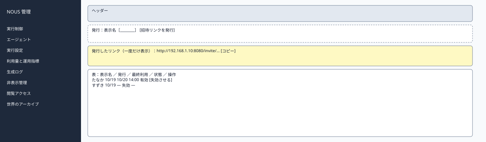
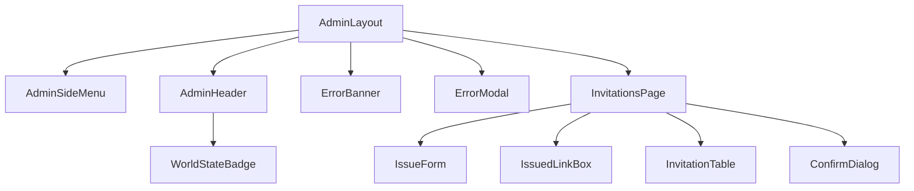

# P210 閲覧アクセス管理

| 項目 | 内容 |
| :--- | :--- |
| 文書番号 | BD-NOUS-SC-P210 |
| 版数 | v1.3（409 LAN_ADDRESS_NOT_FOUND を追加。NOUS-32） |
| 作成者 | Takaya Ishikawa（開発担当） |
| レビュー担当 | Kouhei Tajima（再鑑担当） |
| 関連チケット | NOUS-24 |

## 1. 画面概要

| 項目 | 内容 |
| :--- | :--- |
| 画面ID | P210 |
| 画面名 | 閲覧アクセス管理 |
| パス | /invitations（管理サーバー） |
| 概要 | 招待者ごとに招待リンクを発行し、一覧と最終利用の時刻を確認し、失効させる。招待リンクは発行のときに一度だけ表示する。 |
| アクター | 管理者 |
| 認証要否 | 要（管理セッション） |
| 前画面 | サイドメニュー |
| 後画面 | なし（同じ画面で操作） |
| 対応ソースファイル | apps/admin/src/pages/InvitationsPage.tsx |
| カラーテーマ | 管理（サイドメニュー #1E293B、背景 #F1F5F9。基本設計書（概要）3章） |
| 対応する要件 | SC-208、FR-408、NFR-S-006、Q-011、Q-315 |

## 2. ワイヤーフレーム

### 2.1 ワイヤーフレーム（モバイル）

該当なし。管理画面は管理者の端末（PC）だけを対象とし、最小幅 1024px で設計する（基本設計書（概要）3章）。

### 2.2 ワイヤーフレーム（デスクトップ）（該当する場合のみ）

### 2.3 画面レイアウト説明

上部に発行の行、その下に発行した直後だけ現れる招待リンクの枠、さらに下に招待の一覧の表を置く。

## 3. UI構成・コンポーネント定義

### 3.1 コンポーネントツリー

### 3.2 コンポーネント一覧

| コンポーネントID | コンポーネント名 | 種別 | Props | 内部State | 役割・概要 |
| :--- | :--- | :--- | :--- | :--- | :--- |
| C01 | AdminLayout | Layout | children | - | 管理画面の共通の枠。サイドメニュー（幅 240px）・ヘッダー・メイン（最大幅 1200px） |
| C02 | AdminSideMenu | Layout | current (string) | - | 8 つのメニュー。現在の画面を強調する |
| C03 | AdminHeader | Layout | world (AdminWorld) | - | 世界の状態のバッジ・世界内時間・ログアウト |
| C04 | WorldStateBadge | UI | state、stopReason | - | 状態の色付きのバッジ |
| C05 | ErrorBanner | UI | message | - | 様式②の赤色バー |
| C06 | ErrorModal | UI | message、onClose | - | 様式①のモーダル |
| C07 | InvitationsPage | Page | - | items、issuedUrl (string) | 発行・一覧・失効 |
| C08 | IssueForm | UI | onIssue | label | 表示名の入力と発行 |
| C09 | IssuedLinkBox | UI | url | copied (boolean) | 発行したリンクとコピー。画面を離れると消える |
| C10 | InvitationTable | UI | items | - | 招待の一覧 |
| C11 | ConfirmDialog | UI | message、onConfirm | - | 失効の確認 |

## 4. 画面項目定義

| 項目ID | 項目名 | 種別 | 必須 | データ型 | 制約・初期値 | 表示条件 | 備考 |
| :--- | :--- | :--- | :--- | :--- | :--- | :--- | :--- |
| A01 | サイドメニュー | リンク | - | string | 実行制御・エージェント・実行設定・利用量と運用指標・生成ログ・非表示管理・閲覧アクセス・世界のアーカイブ | 常時表示 | 現在の画面を背景 #334155 で強調 |
| A02 | 世界の状態のバッジ | 表示 | - | string | 準備中・稼働・一時停止・上限停止・緊急停止（色は概要 3章の状態の色） | 常時表示 | GET /admin/api/world を 5 秒ごとに取得 |
| A03 | 世界内時間 | 表示 | - | string | 「第 N 日 HH:MM」 | 常時表示 | - |
| A04 | ログアウト | ボタン | - | - | 固定文言 | 常時表示 | 押すと POST /admin/api/logout |
| H01 | 表示名 | 入力 | 必須 | string | 1〜30 字。招待者を区別する呼び名 | 常時 | 氏名・メールアドレスを入れない旨を placeholder に表示（Q-315） |
| H02 | 招待リンクを発行 | ボタン | - | - | 固定文言 | 常時 | - |
| H03 | 発行したリンク | 表示 | - | string | http://端末の LAN の IP:8080/invite/トークン | 発行の直後だけ | 画面を離れると二度と表示しない |
| H04 | コピー | ボタン | - | - | 固定文言 | H03 があるとき | - |
| H05 | リンクの注意 | 表示 | - | string | 「このリンクは今だけ表示されます。招待する人に直接渡してください」 | H03 があるとき | - |
| H06 | 一覧の表示名 | 表示 | - | string | invitations.label | 行ごと | - |
| H07 | 発行日時 | 表示 | - | string | YYYY/MM/DD HH:MM（JST） | 行ごと | - |
| H08 | 最終利用 | 表示 | - | string | YYYY/MM/DD HH:MM（JST） | 行ごと | なければ「―」 |
| H09 | 状態 | 表示 | - | string | 有効（緑）・失効（灰） | 行ごと | - |
| H10 | 失効させる | ボタン | - | - | 固定文言 | 有効の行 | 確認のダイアログ |
| H11 | LAN の IP アドレス | 表示 | - | string | 「この端末の LAN のアドレス：192.168.x.x」 | 常時 | GET /admin/api/invitations の lanAddress。リンクの組み立てに使うアドレスを示す |
| H12 | 0 件の表示 | 表示 | - | string | 「招待はまだありません」 | 0 件のとき | - |

## 5. イベント定義

| イベントID | 発生源 | トリガー | 条件 | 処理概要 | 呼び出しAPI | 成功時の挙動 | 失敗時の挙動（様式ID + 説明） |
| :--- | :--- | :--- | :--- | :--- | :--- | :--- | :--- |
| E01 | ページ | ページロード | 画面遷移時 | 招待の一覧を取得する | GET /admin/api/invitations | 表を描画する | 様式①: 401 は P201、500 |
| E02 | 招待リンクを発行（H02） | Click | H01 が検証に通る | 招待を発行する | POST /admin/api/invitations | H03 を表示し、一覧に足し、H01 を空にする | 様式④: 400 の文言。様式②: 409 LAN_ADDRESS_NOT_FOUND。様式①: 500 |
| E03 | コピー（H04） | Click | H03 がある | リンクをクリップボードに写す | なし | トースト「コピーしました」 | 該当なし |
| E04 | 失効させる（H10） | Click → 確認 | 有効の行 | 失効させる | POST /admin/api/invitations/:invitationId/revoke | 行を失効にし「失効させました。次の閲覧から見られなくなります」 | 様式②: 409 ALREADY_REVOKED。様式①: 500 |
| E05 | ページ | 離脱 | H03 が表示中 | 「招待リンクはもう表示できません。コピーしましたか」の確認 | なし | 確認で移動 | 該当なし |
| E06 | ログアウト（A04） | Click | 常時 | セッションを削除する | POST /admin/api/logout | P201 へ遷移 | 様式①: 失敗しても Cookie を消して P201 へ |

### 5.1 エラー表示様式定義

| 様式ID | 様式名 | 表示方法 | 使用コンポーネント | 使用場面 | ユーザー操作 |
| :--- | :--- | :--- | :--- | :--- | :--- |
| 様式① | ポップアップ表示 | モーダルダイアログで画面中央にエラーメッセージを表示 | ErrorModal | サーバーエラー（500）、通信エラー、セッション切れ（401） | OK で閉じる。401 は P201 へ遷移 |
| 様式② | 画面上部表示 | 画面上部（ヘッダー直下）に赤色バーでメッセージを表示 | ErrorBanner | 状態の衝突（409）、CSRF の不一致（403） | 最新の状態を読み直し、操作をやり直す |
| 様式③ | 全画面エラー | 該当なし | 該当なし | 該当なし | 該当なし |
| 様式④ | 入力欄下表示 | 対象の入力フィールド直下に赤文字でインラインエラーを表示 | FieldError | 表示名の未入力・超過 | 入力を直すと消える |

**この画面で使用するエラー様式の詳細**:

| 様式ID | エラー発生条件 | エラーメッセージ文言 | 補足（遷移先・復帰手順） |
| :--- | :--- | :--- | :--- |
| 様式① | 401 ADMIN_UNAUTHORIZED（セッション切れ） | 「ログインの有効期限が切れました。もう一度ログインしてください」 | OK で P201 へ遷移 |
| 様式① | 発行・失効の API が 500 | 「操作に失敗しました。時間をおいて再度お試しください」 | OK で閉じる |
| 様式② | 409 ALREADY_REVOKED | 「この招待はすでに失効しています」 | 一覧を読み直す |
| 様式② | 409 LAN_ADDRESS_NOT_FOUND | 「この端末の LAN のアドレスが見つかりません。端末がネットワークにつながっているか確かめてください」 | ネットワークにつないでから発行し直す |
| 様式④ | 表示名が空・31 字以上 | 「1〜30 字で入力してください」 | 入力を直す |

## 6. バリデーション・制約定義

| 対象項目ID | 項目名 | ルール | エラーメッセージ |
| :--- | :--- | :--- | :--- |
| H01 | 表示名 | 必須。1〜30 字 | 「1〜30 字で入力してください」 |

## 7. 画面固有の業務ルール・注意事項

* トークンはハッシュだけを保存するため、発行の後に招待リンクをもう一度表示する手段はない。なくした場合は失効させて発行し直す
* 招待者について保存するのは表示名・トークンのハッシュ・発行と失効の日時だけ（Q-315）
* 招待リンクは同じネットワークの中からだけ使える（NFR-S-009）
* 発行・失効は管理操作履歴に残る
